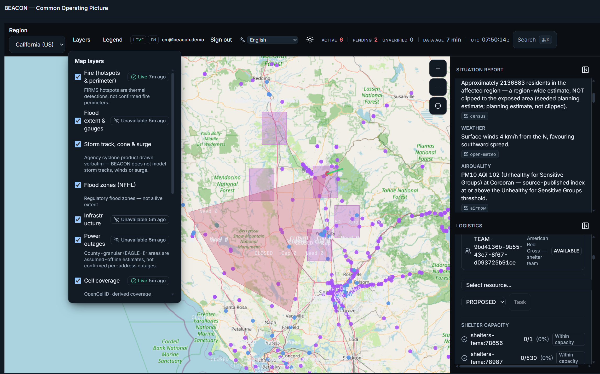
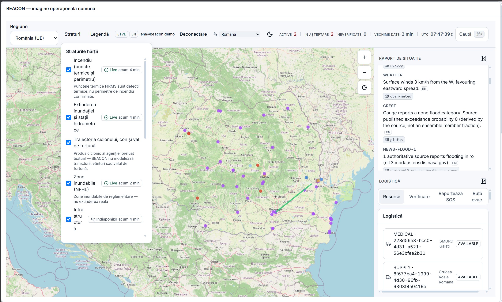
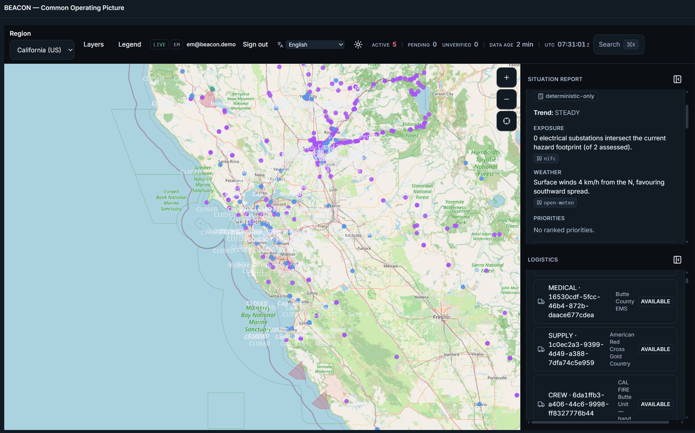
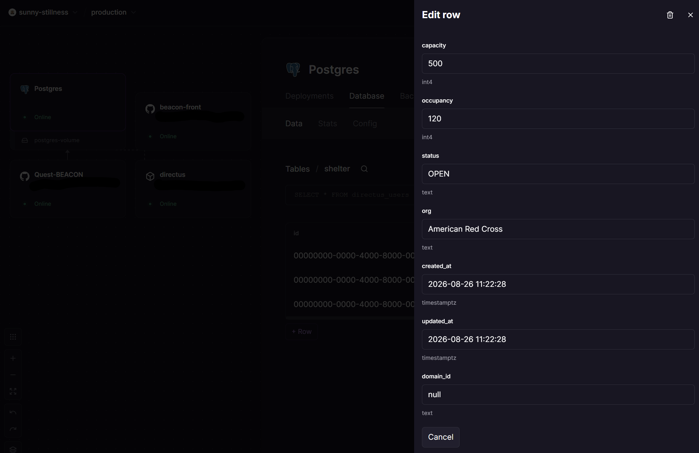

# Browser-based Emergency Awareness & Coordination Open Network - Common Operating Picture

> Open-source, **local-first**, near-real-time **common operating picture (COP)** for wildfires and floods.
> Emergency reporting and management in a one responsive browser app that ingests free/authoritative data
> through pluggable adapters, fuses it into a **source-cited AI situational report**, and ties it to 
> **responder logistics** — working (at $0), so a real agency could self-host it with no licensing or lock-in.
>
> **IEEE Response Quest™ 2026 · Phase 3 (product)** · entry #5320 · Apache-2.0 · by Andrei N Besleaga


> ### 🔎 Judges & first-time readers — start here: **[JUDGE_MATRIX.md](JUDGE_MATRIX.md)**
> One page, built for a fast scan: what was promised vs what shipped, the five judging criteria with
> evidence, production readiness, what's genuinely new, and the honest limitations. Everything below and
> throughout `docs/` is the supporting detail behind it.

> **Access.** Repository: https://github.com/andreibesleaga/QUEST-BEACON (public) · Live deployment: https://quest-beacon.up.railway.app (brought online for the judging window and on request; its public picture needs no account, and the operator sign-in accounts are supplied with the entry). No access is needed to evaluate: **the uploaded archive is the complete, self-contained product** — `docker compose -f infra/docker-compose.yml up -d --build` reproduces the full COP with zero keys and zero network.

## Why it exceeds the brief




Promised a concept → shipped a **live deployment** and one-command local reproduction with zero keys.
Promised some live sources → **45 adapters**, 38 live-capable. Promised a US demo → **5 regions on 3
continents, 14 locales**. Promised WCAG 2.1 AA → shipped **2.2 AA with a CI gate**. Promised cited AI →
shipped an LLM that **structurally cannot emit a number**, provable in one toggle. Promised human-in-the-loop
→ enforced **at the type level** behind a fail-closed AI-compliance gateway. Promised CAP/EDXL → **full
round-trips**. Promised push → **SSE in ~1.7 s**, trustworthy picture in **~1 s**.

Beyond the brief entirely — all working in the live demo: early warning, COP, cited synthesis and
logistics on **one model** · anticipatory-action protocols as config · live cameras and external context
deep-links · cross-domain corroboration · a drill mode that *cannot* reach a real channel · a sustainability
disclosure endpoint. → **[JUDGE_MATRIX.md](JUDGE_MATRIX.md)** for the evidence behind each.

## Why it matters
During a wildfire or flood an emergency manager juggles half a dozen sites and stitches the picture
together by hand while minutes matter. The bottleneck is **integration + synthesis + logistics**, not raw
data. BEACON replaces that scramble with one trustworthy picture, and its distinguishing property is a
discipline rather than a feature: **the deterministic engine owns every number and cites its source · the
LLM only narrates and is structurally prevented from emitting a figure · no public alert leaves the system
without a named human approving it, enforced at the type level.**

## What is built
**A complete, tested product — not a prototype.** The full hexagonal spine is implemented, gated in CI,
and reproducible on any machine with one command.

| | |
|---|---|
| **45 source adapters** registered, 41 consumed | fire, flood, weather, alerts, infrastructure, outages, cell, air quality, population, news, vetted social, cameras |
| **14 COP map layers** | each with its own LIVE/CACHED/MOCK freshness badge |
| **5 regions · 14 locales** (RTL: ar, ur) | three continents, added by configuration — no code change |
| **5,378 tests** passing, 0 boundary violations (911 modules) | plus Playwright across 5 zones × 4 devices, axe WCAG 2.2 AA, a real offline reload |
| **36 API paths**, zero documented-but-unserved | CAP v1.2 + EDXL-RM + EDXL-SitRep round-trips |
| **≈ $0 to run** | free/open data, open-source stack, one machine or free-tier cloud |

**Working end-to-end today:** the cited SitRep with deterministic news fusion · fire and flood prediction
with method/inputs/uncertainty on every figure · NFHL∩crest predicted impact · consent → triage → human
verification → CAP alert · hazard-avoiding evacuation routing with real ORS road routes · the logistics
board with tasking, shelter capacity-vs-demand and pre-positioning from predictions · real SSE push
(~1.7 s to a listening browser) · durable Postgres persistence · a fail-closed AI-compliance gateway in
front of every model call · real Telegram broadcast of human-approved alerts · live camera layers and
external context deep-links · a WCAG 2.2-AA crisis-first UI that works air-gapped · an installable,
offline-capable browser app (flag, ADR-047) that keeps the last public picture and says when it was saved.

**Repository:** https://github.com/andreibesleaga/QUEST-BEACON (public) · **Live deployment:** https://quest-beacon.up.railway.app — production posture, named-account sign-in, online for the judging window and on request. Not required: the uploaded archive is the complete product and runs locally with one command (below).

*Where the detail lives:* per-source verdicts in
[`docs/audit/DATA_SOURCE_VERIFICATION.md`](docs/audit/DATA_SOURCE_VERIFICATION.md) · the delivery history in
[`CHANGELOG.md`](CHANGELOG.md) · the contract of record in [`docs/SPEC.md`](docs/SPEC.md) · the
criteria-by-criteria evidence map in [`JUDGE_MATRIX.md`](JUDGE_MATRIX.md).

## Four flagship capabilities
1. **Unified live geospatial COP** — timestamped layers: fire, flood gauges/forecasts, weather/alerts,
   infrastructure, power outages, cell coverage; per-layer freshness badges.
2. **AI situational-intelligence fusion** — news + vetted signals + geospatial risk → a ranked, **cited**
   SitRep with escalation trend and threshold-triggered DRAFT alerts; misinformation flagged, never trusted.
3. **Responsible crowdsourced SOS + evacuation routing** — consent → AI triage/confidence → human
   verification → CAP alert; hazard-avoiding routes + shelter capacity.
4. **Responder logistics** — live resource registry, tasking, shelter capacity-vs-demand, full
   **EDXL-RM mutual-aid round-trip** + CAP v1.2 interop.




## Orient in 5 minutes
| Read | For |
|---|---|
| [docs/QUICK_GUIDE.md](docs/QUICK_GUIDE.md) | one-page map of everything |
| [docs/USER_GUIDE.md](docs/USER_GUIDE.md) | **what you see and what to trust** — for anyone who opens the COP |
| [docs/OPERATOR_GUIDE.md](docs/OPERATOR_GUIDE.md) | **how to use it** — SitRep, logistics/tasking, evacuation routing, offline, per role |
| [docs/RELEASE_GUIDE.md](docs/RELEASE_GUIDE.md) | **release + live deployment** — every supported variable, what a live deployment must set, verify, rotate, the demo switch |
| [docs/DEVELOPER_HANDBOOK.md](docs/DEVELOPER_HANDBOOK.md) | **the whole system end to end** — architecture, code map, request and composition flows, plugin points, debugging playbook, failure table, reviewer questions |
| [docs/DEPLOYMENT.md](docs/DEPLOYMENT.md) | **deploy it anywhere** — laptop, Docker host, Railway (reference), Kubernetes (`infra/k8s/`), Cloud Run/ECS/Fly; the four postures and the build-time-vs-runtime trap |
| [docs/LIVE_PRODUCTION_GUIDE.md](docs/LIVE_PRODUCTION_GUIDE.md) | **run it for real** — every source live, real Postgres, real AI/alerts/routing, worldwide (and the honest ceiling: **38 of 45** adapters can serve live) |
| [docs/architecture/C4_ARCHITECTURE.md](docs/architecture/C4_ARCHITECTURE.md) | **architecture diagrams** (C4 L1–L3 + runtime flows) + the ADR index (001–047) |
| [docs/SPEC.md](docs/SPEC.md) | the contract of record — **§13 is the limitations ledger** |
| [docs/SUMMARY.md](docs/SUMMARY.md) | executive summary of the spec base |
| [docs/requirements/PRD.md](docs/requirements/PRD.md) | requirements (FR-1…16, EARS) |
| [docs/audit/DATA_SOURCE_VERIFICATION.md](docs/audit/DATA_SOURCE_VERIFICATION.md) | every data source, verified, with fallbacks (US · Romania · worldwide) |
| [project/TASKS.md](project/TASKS.md) | the build backlog + execution model |
| [docs/ENGINEERING_PRINCIPLES.md](docs/ENGINEERING_PRINCIPLES.md) | the quality bar every phase honors |
| [JUDGE_MATRIX.md](JUDGE_MATRIX.md) | **the state hub** — verification snapshot, Phase-2 → Phase-3 delivery map, the five judging criteria with evidence, production readiness, honest limitations, innovations, roadmap |

## Principles (enforced, not aspirational)
Provenance + citations on everything · deterministic source of truth (LLM never computes a number) ·
human-in-the-loop before any public action · **total redundancy** (every layer has a fallback ladder;
offline/air-gapped works) · free/open data only · fail-closed AI-compliance gateway on every model call ·
WCAG 2.2 AA crisis-first UX.


## Run it — one command, no keys, no network
From this directory (the project root — `Phase3/` in the current monorepo layout):
```bash
docker compose -f infra/docker-compose.yml up -d --build   # Postgres → migrations → app
open http://localhost:3000
```
That is the whole setup. **No API key, no account, no egress** — the stack ships air-gapped by default
(`AI_MODE=off`, sources cached/mock) and still renders a full COP with its built-in demo seed. Demo zones:
**California**, **Romania**, Spain, Greece, Philippines. Walkthrough:
[docs/DEMO_SCRIPT.md](docs/DEMO_SCRIPT.md).

> ⚠️ The compose file lives at `infra/docker-compose.yml`, so the `-f` flag is **required** — a bare
> `docker compose up` from the project root exits 1 with *"no configuration file provided: not found"*.
> Tear down with `docker compose -f infra/docker-compose.yml down -v`.
> The command above is the **offline** judge path and is meant to land on the air-gapped defaults. For
> the **live** posture use `npm run docker:up` instead — it renders your `.env` into the compose
> env-file first; bare compose skips that and falls back to the offline defaults.
> To develop without Docker: `nvm use && npm install && npm run dev`.

Backend Database is already populated with demo/mock/real data, and it can always be changed/updated, via deployment tools or other CRUD UIs (like the live production deployment Directus).




## Gates — machine-produced, not asserted from memory
| Gate | Command | Result |
|---|---|---|
| Lint | `./node_modules/.bin/eslint .` | **0** |
| Types | `./node_modules/.bin/tsc --noEmit` | **0** |
| Unit/integration | `./node_modules/.bin/vitest run` | **5378 passed / 6 skipped (5384), exit 0** (2026-09-16) |
| Integration (real Postgres) | `npm run test:integration` | **18 passed** against PostgreSQL 16 (2026-09-11). Opt-in via `DATABASE_URL_TEST`; absent ⇒ skipped, so `npm test` and CI are unaffected. It applies the REAL migration files rather than pushing the schema, because the defect it was built for lived in a migration the schema definition knew nothing about |
| …with coverage | `./node_modules/.bin/vitest run --coverage` | **green, every floor met (2026-09-15: 96.0 % statements / 90.9 % branches overall)** — and now enforced on every PR by CI. Its first CI run *failed* at 98.97% branch coverage against the 99% `src/application/**` floor: real drift accumulated since 2026-08-02, closed by covering `newsOutletProvenance`'s degrade branches. The floor was **not** lowered |
| Architecture boundaries | `./node_modules/.bin/depcruise src app` | **0 violations across 911 modules** (2026-09-15) |
| API contract | `npm run docs` (`tests/api/openapi-contract.test.ts`) | **36 paths · 39 operations · 66 schemas**; every operation with an id, summary and responses; every operation but the unauthenticated `/health` liveness probe declares its minimum role; every `$ref` resolves (2026-09-15) |
| Dependencies | `npm audit --audit-level=high` | **exit 0 — 0 high / 0 critical** (7 moderate, dev-only; re-measured **2026-09-11**). This gate was **RED** on 2026-09-11 before that measurement: 2 critical (unauthenticated RCE in Next.js ×2, and an XSS sanitizer bypass in the library that renders the map) and 3 high. Cleared by patching the non-breaking set and taking `maplibre-gl` 5→6 for the critical, which needed a source change for its v6 named export. Recorded here rather than quietly re-measured, because a gate that was red is a fact about the project |
| Build | `./node_modules/.bin/next build` | ✅ (2026-09-15) |
| Browser | `./node_modules/.bin/playwright test` | **214 passed / 26 skipped / 0 failed** (2026-09-15), run on every PR by CI on a clean runner across 4 device projects × 5 zones, including a real offline reload through the service worker (`e2e/pwa-offline.spec.ts`). The 2026-08-10 "mid-re-baseline" state (5 moved visual baselines + 2 flake classes) is fully resolved: baselines re-minted, and the flakes root-caused to a stale reused web server (`reuseExistingServer` now off by default). Read the WebGL caveat above before quoting this |

Every row was re-run on **2026-09-15** on the commit this README ships with; each carries its own
machine-produced date rather than being restated as fresh, because *"an unverified thing is
'unverified', never 'fine'"* is the rule this project is graded against. **Every figure on this page must
be re-produced on the tagged commit; a stale gate figure in a README is precisely the drift class this
project has been fighting, and it has bitten here before** (`depcruise 0/723`, `301 files / 3615 tests`,
`Playwright 86 passed` were all wrong at the time they were displayed).
**Hexagonal boundaries are machine-enforced, not merely described** — the rules live in
[`.dependency-cruiser.cjs`](.dependency-cruiser.cjs) and "0 violations across 911 modules" is the claim.

## Repo layout note
`docs/audit/` holds the audits of record: the **Phase-2 carry-over** (Phase-2 review and clarified
decisions under `docs/audit/v1/`), the **living data-source verification catalog**
(`docs/audit/DATA_SOURCE_VERIFICATION.md`), and the **dated Phase-3 audits** (`FINAL_AUDIT-2026-06-29.md`,
`FINAL_LIVE_AUDIT-2026-08.md`, `FINAL-AUDIT-2026-09-16.md`, external and live verification, the
unimplemented register).
The product was built with a governed, AI-assisted SDLC whose working files are not part of the
repository; its durable output — decisions, ADRs, audits, task ledgers — is committed under `docs/` and `project/`. Security disclosures: [SECURITY.md](SECURITY.md). Contributing:
[CONTRIBUTING.md](CONTRIBUTING.md) · [CODE_OF_CONDUCT.md](CODE_OF_CONDUCT.md).

## License & attribution
**Apache-2.0** ([LICENSE](LICENSE)). Data-source attributions: [NOTICE](NOTICE) — all 45 wired sources
listed with their licence and required credit. Built with free/open data (NASA, NOAA, USGS, Copernicus,
OSM, UN OCHA, and more — all verified + attributed).

*Phase-2 concept was accepted (jury 4.48/5). AI-assisted engineering (disclosed in the entry): specs and
build are produced with LLM agents under a governed SDLC with human gates — the same
deterministic→AI→human principle the product itself implements.*

---

## What is honestly not done
Everything above is built, tested and running. What follows is the short, deliberate list of what is
**not** — stated openly because honest limitation is part of this product's integrity, and because a
system used in an emergency must never overstate itself. None of it blocks the delivered product; each
item is tracked, and most are on the roadmap. Full ledgers:
**[`docs/SPEC.md` §13](docs/SPEC.md)** and
**[`docs/audit/UNIMPLEMENTED_REGISTER.md`](docs/audit/UNIMPLEMENTED_REGISTER.md)**. In short:

- **Map *contents* are not browser-asserted.** The gates run with WebGL disabled and photograph the
  accessible fallback list; one spec (`e2e/webgl-smoke.spec.ts`) proves a live GL canvas on all four
  device projects, but layer and geometry correctness rests on unit tests, not on a browser looking at
  the real map.
- **The five dock panels are operator data, not a public feed.** Under `FEATURE_STORE=postgres` each panel
  (supplies, volunteer teams, shelter status, damage reports, EMS overlay) reads the operator-maintained
  store and is labelled `DB`; on the memory posture, or while its table is empty, it shows recorded
  fixtures labelled `MOCK` and says why. `npm run db:seed` provides a starting set for supplies, volunteer
  teams, damage reports and the shelter roster (an EM edits them in Directus); no public feed publishes a
  county's pallet count, so nothing here is presented as an outside fact. The EMS overlay has no seed rows
  on the merits — its table wants the publisher's own product id and the recorded Copernicus page carries
  only activation codes — so it stays fixture-fed. California's shelter *directory* on the map is FEMA-live
  (`shelters-fema`, 2026-09-11). Their provenance says so in the UI.
- **Three D5/D6 modules stay registered but uncomposed by plan** — rumor board, mutual aid,
  reunification links.
- **Seven of 45 adapters cannot serve live on free public routes** — ITU and CAMARA/GSMA are
  operator-gated by design; USGS-Water's OGC migration is partial; `hifld` is a static-2019 package held
  out of every region; CNADNR publishes no machine-readable feed; EAGLE-I needs an endpoint the operating
  agency is entitled to; EFFIS has no keyless feature-query endpoint at all — *corrected 2026-09-12: this
  line used to say its response shape was "ours to fix, not theirs", and that was wrong. The endpoint now
  answers `301` to a host that is an S3 static-file portal, which has no ArcGIS/GeoJSON query service
  behind it. EFFIS publishes WMS map images, not queryable features, so there is nothing for this adapter
  to parse and it stays cached.* The other **38 can serve live**, 29 of them with no key at all.
  *Re-verified 2026-09-10/11: GloFAS is keyless and live again (it had been decommissioned), and ANM's TLS
  handshake now succeeds — both were listed here as permanently blocked and both were wrong.* Each is named with its evidence in
  [`docs/LIVE_PRODUCTION_GUIDE.md`](docs/LIVE_PRODUCTION_GUIDE.md) §1.
- **The outage layer is inference, not observation** — "ASSUMED offline" from hazard ∩ infrastructure at
  county granularity, labelled as such wherever it appears.
- **Persistence:** under `FEATURE_STORE=postgres` the SitRep/citation stores, the evacuation-route trail
  and the live provenance mirror are all composed and written (ADR-039, 2026-09-10) — they had been built
  and called by nothing. California's shelters now come from FEMA's live directory rather than a seed
  (2026-09-11). The memory posture is unchanged and still derives SitReps fresh on every read.
- **The LLM likelihood-word guard covers English narration only.**
- **Telegram, vision and CAMARA default to mock/off** until their environment is set.

The gates above ran offline, on MOCK sources, with AI off — deliberately, so the numbers reproduce on
any machine with zero keys and zero egress. Running everything live is documented separately in
[`docs/LIVE_PRODUCTION_GUIDE.md`](docs/LIVE_PRODUCTION_GUIDE.md).
