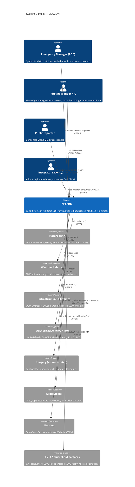
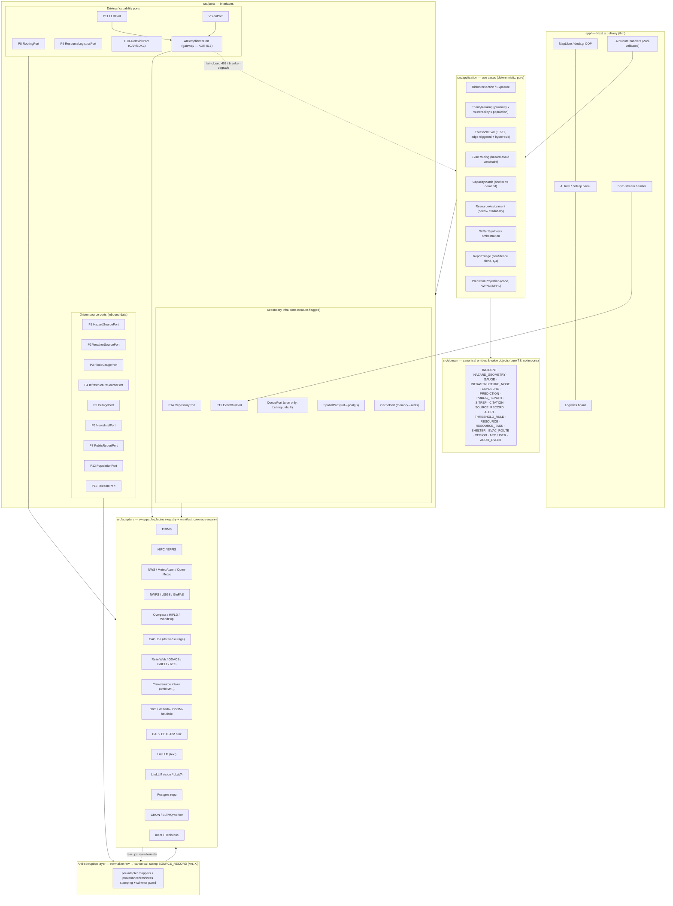
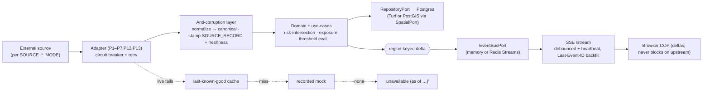
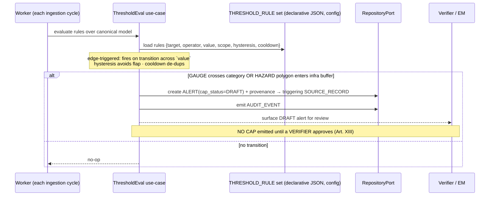
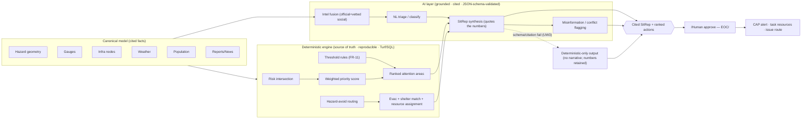
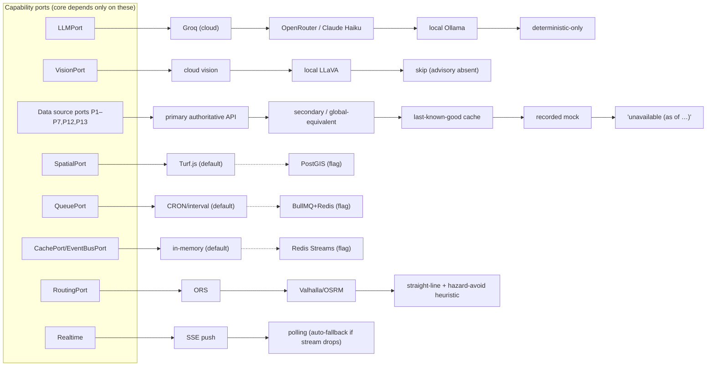
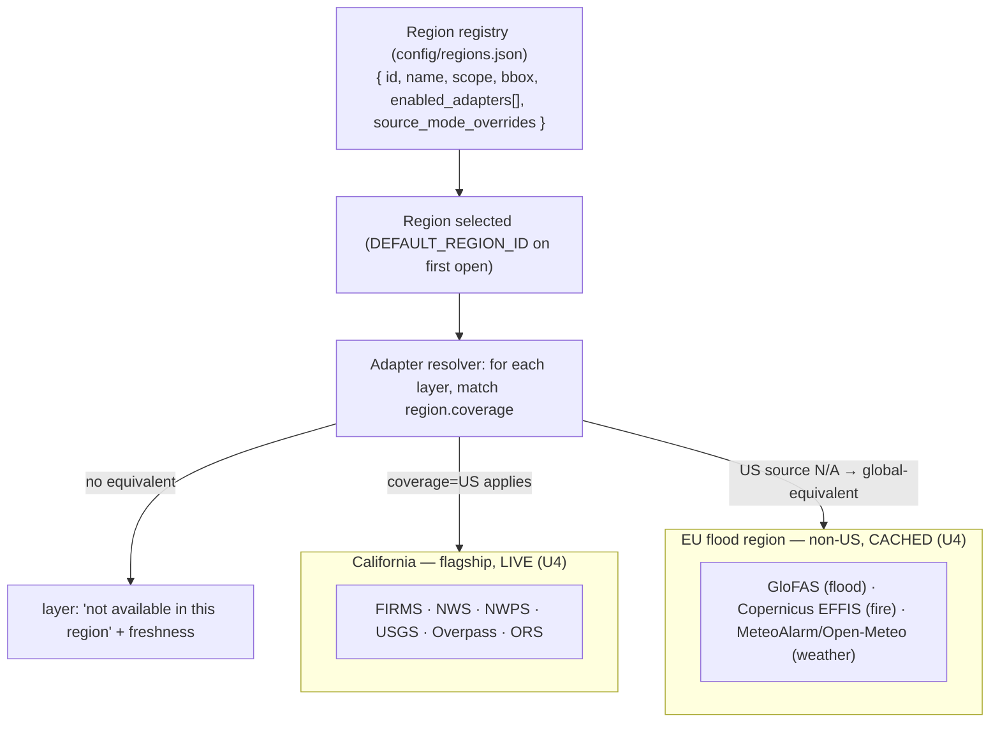
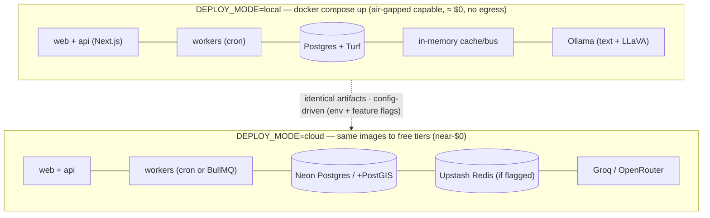

# C4 Architecture — BEACON

<!-- C4 Model: 4 levels of abstraction for software architecture · https://c4model.com -->
<!-- Author: prod-architect (GABBE SDLC S02) · Project: BEACON — IEEE Response Quest 2026, Phase 3 -->
<!-- All diagrams are Mermaid so they render in GitHub and in the submission. -->

> **BEACON** — Browser-based Emergency Awareness & Coordination Open Network: an open-source,
> local-first, near-real-time **common operating picture (COP)** for wildfires and floods. Ingests
> free/authoritative data via pluggable adapters, fuses it into a **source-cited** AI situational
> report, and ties it to responder logistics — with **total redundancy** (Article XVI) at ≈ $0.
>
> **Authority chain.** This doc refines the Phase-2 `../../../Phase2/submission/ARCHITECTURE.md` against
> the **LOCKED stack** in `docs/audit/v1/CLARIFICATIONS.md §D`, the S01 `../requirements/PRD.md` EARS, the
> feature-flag contract in `./CONFIGURATION.md`, and the binding `../../agents/CONSTITUTION.md` Articles
> **XI–XVI**. Where Phase-2 said "flexible/illustrative" (or strayed into NestJS/PostGIS/BullMQ as
> defaults), §D wins: **Next.js/TS, CRON-default↔BullMQ-flag, Postgres+Turf-default↔PostGIS-flag,
> in-memory↔Redis-flag, SSE**. Scale is a flag, never a fork.

---

## 0. Architecture at a glance (drivers → decisions)

| Driver (PRD / CLARIFICATIONS / Constitution) | Architectural response |
|---|---|
| Provenance + citations always (U1/U2, Art. XI) | Anti-corruption layer stamps `SOURCE_RECORD`; envelope `{data, provenance[], freshness}`; SitRep `citations[]` — **enforced by contract test** |
| LLM never invents numbers (U3, Art. XII) | Deterministic engine (`src/application` over `src/domain`, Turf/SQL) owns all figures; `LLMPort` narrates JSON-schema-validated cited facts only |
| Human-in-the-loop before public action (EV5/ST1/UW5, Art. XIII) | `PUBLIC_REPORT` state machine + `CAP_EMIT_MODE=draft`; threshold rules → DRAFT alert only; every state change → `AUDIT_EVENT` |
| Total redundancy / offline (UW1–UW4, Art. XVI) | Every port has a **feature-flagged fallback ladder**; identical artifacts local (air-gapped) ↔ cloud |
| Config for everything (U5, Art. XV) | 12-factor env (`./CONFIGURATION.md`); fail-fast boot validation; no hardcoded endpoint/key/model/region |
| Multi-region, global-equivalents (OP4, Art. XI, Q9) | Region registry + adapter `coverage` declaration + global-equivalent adapters (GloFAS/EFFIS/MeteoAlarm) |
| Identical local & cloud (NFR portability, Art. XVI) | One Docker image set; `DEPLOY_MODE` flag; cloud = managed Postgres/Redis substituted behind the same ports |

The spine is **hexagonal ports-and-adapters + DDD** (Art. II): `domain → application → ports → adapters`,
with an **anti-corruption layer (ACL)** at every inbound boundary. Breadth and redundancy live in the
adapters; the core never changes when a source, region, or provider does (Art. XV).

---

## Level 1 — System Context Diagram

> Who uses BEACON and which external systems it talks to. Four personas (PRD §3, C8): EM, Responder/IC,
> Public reporter, Integrator.



**Boundary notes (Art. XI/XIII):** BEACON **produces + validates** CAP v1.2 ready for IPAWS but performs
**no live IPAWS origination** (FEMA authority — out of scope, `IPAWS_ENABLED=off`). All external data is
**free/open first-class free-world** (UN/Copernicus/NASA/NOAA/USGS/OSM/WorldPop); no paid feeds, no
scraping ToS-protected platforms.

---

## Level 2 — Container Diagram

> Deployable units inside the BEACON boundary, reflecting the LOCKED stack. Dashed external systems are
> the **flagged scale rung** (Redis) or **optional providers** — none is required for core function.

```mermaid
C4Container
    title Container Diagram — BEACON (LOCKED stack; scale rungs flagged)

    Person(user, "Responders / EOC / Public", "Browser (desktop/tablet/phone) · SMS gateway")

    System_Boundary(beacon, "BEACON") {
        Container(web, "Web UI", "Next.js (App Router) + MapLibre GL JS + deck.gl + Tailwind + Zustand + TanStack Query", "Responsive COP, AI intel panel, logistics board; SSE delta subscriber")
        Container(api, "API routes (BFF)", "Next.js API routes (TypeScript)", "Thin handlers → application use-cases; envelope {data,provenance[],freshness}; SSE /stream")
        Container(core, "Domain + Application core", "TypeScript (framework-agnostic, hexagonal)", "Deterministic engine: risk-intersection, priority ranking, threshold eval, routing-constraints, capacity match, SitRep orchestration")
        Container(workers, "Ingestion / synthesis workers", "CRON/interval (default) ↔ BullMQ (flag)", "Poll adapters → ACL → domain → store → publish delta; threshold eval each cycle")
        ContainerDb(pg, "Canonical store", "PostgreSQL + Turf.js geo-compute (default) ↔ PostGIS (flag)", "REGION, INCIDENT, HAZARD_GEOMETRY, EXPOSURE, PUBLIC_REPORT, ALERT, RESOURCE, AUDIT_EVENT, SOURCE_RECORD …")
        Container(bus, "Cache / event bus", "In-memory (default) ↔ Redis Streams (flag)", "Last-known-good cache, region-keyed delta bus")
        Container(proxy, "AI Compliance Proxy", "AICompliancePort gateway (in-process, ADR-017)", "MANDATORY chokepoint for every LLM+Vision call: JWT/role → breaker → semantic firewall → policy-as-code → PII redact → cost guardrails (ADR-018) → hash-chained audit + OTel GenAI spans (ADR-022). Safety fail-closed; availability degrades the ladder")
        Container(llm, "LLM / Vision router", "LiteLLM (LLMPort + VisionPort)", "Groq → OpenRouter/Claude Haiku → Ollama → deterministic-only; vision: cloud → LLaVA → skip — reachable ONLY via the proxy (adapters reject un-stamped calls)")
    }

    System_Ext(sources, "Data sources (adapters)", "FIRMS, NWS, Overpass, NWPS, USGS, GloFAS, EFFIS, ReliefWeb, GDELT …")
    System_Ext(routing, "Routing", "ORS → Valhalla/OSRM → heuristic")
    System_Ext(partners, "CAP / EDXL-RM partners")
    SystemDb_Ext(redis, "Redis (optional)", "Only if FEATURE_CACHE/QUEUE/EVENTBUS = redis/bullmq")

    Rel(user, web, "Uses", "HTTPS")
    Rel(web, api, "REST + SSE", "HTTPS/JSON, text/event-stream")
    Rel(api, core, "Invokes use-cases", "in-process")
    Rel(core, pg, "Read/write canonical model", "TCP/5432")
    Rel(core, bus, "Publish/subscribe deltas, cache", "in-proc / TCP")
    Rel(workers, sources, "Poll (per SOURCE_*_MODE)", "HTTPS")
    Rel(workers, core, "Normalize → domain (via ACL)", "in-process")
    Rel(workers, pg, "Persist", "TCP/5432")
    Rel(workers, bus, "Publish delta", "in-proc / TCP")
    Rel(core, proxy, "Every LLM/Vision call (grounded, cited)", "in-process")
    Rel(proxy, llm, "Screened + audited upstream call", "OpenAI-compatible")
    Rel(core, routing, "Hazard-avoid route", "HTTPS")
    Rel(api, partners, "Emit CAP/EDXL (after human verify)", "HTTPS")
    Rel(bus, redis, "Backed by (when flagged)", "TCP/6379")
```

**Container notes:**
- **API routes are thin** (Art. II): they validate input (Zod), call an application use-case, and serialize
  the envelope. No risk/ranking/threshold logic in a route handler or React component — that is forbidden.
- **Workers** run the ingestion loop and threshold evaluation on a `cron`/interval (zero-dependency,
  air-gapped-safe). `FEATURE_QUEUE=bullmq` is a CONFIGURED-BUT-UNBUILT rung: `QueuePort` is declared in
  `src/ports/infra.ts` and the flag validates `REDIS_URL`, and **no adapter implements the port** — there
  is no `src/adapters/queue/` at all (corrected 2026-09-11; this paragraph previously said "either
  implements the same `QueuePort`", which read as two working rungs when there are none). The port is the
  seam that makes the rung addable without touching core code, which is the architectural claim actually
  supported; a working Redis worker is not.
- **One process can host UI + API + workers** for the lean local demo; cloud may split them — both run the
  **same artifacts** (Art. XVI), differing only by config.
- **AI Compliance Proxy is the single chokepoint** (ADR-017): no path reaches the LLM/Vision router
  without traversing the full JWT→breaker→firewall→policy→PII→cost→audit pipeline; the provider adapters
  reject any call not stamped by the gateway, so it cannot be bypassed. Safety controls (PII egress,
  prompt-injection, blocked-command patterns) are **fail-closed**; availability degrades down the
  ADR-007/008 ladder (breaker-open → local/deterministic-only), never a dead-end (Art. XVI). Full
  control cross-walk in `./COMPLIANCE_MATRIX.md`.
- **Public sustainability surface:** the API exposes `GET /.well-known/sustainability` (ADR-020,
  RFC-v05, out-of-band, modeled/estimated, heavily cached) — a discoverable energy/carbon disclosure
  with **zero per-request overhead** on the crisis hot path.

---

## Level 3 — Component Diagram (hexagonal core)

> Zoom into the Domain + Application core: `domain → application → ports → adapters`, with the ACL at the
> inbound boundary. Ports **P1–P15** plus the infra ports **Queue / Spatial / Cache** are the fixed
> architecture (Rule-of-Three exemption, Art. III) — adapters are swappable behind them.



**Layer import rules (Art. II/VIII — enforced by agentic-linter / dependency-cruiser):**

```
src/domain/        No imports from application, ports, adapters, frameworks, ORM, HTTP, or the LLM client.
src/application/   Imports domain + port interfaces only. Never imports adapters/infra. Pure & testable.
src/ports/         Interfaces only (depend on domain types).
src/adapters/      Implement a port; own the ACL mapping + last-known-good cache + recorded-mock + circuit breaker.
                   MUST NOT leak raw source formats above the ACL; MUST NOT import the domain's persistence.
src/main/          Composition root: DI wiring + adapter registry/manifest + fail-fast config validation.
app/ (Next.js)     Delivery only: route/SSE handlers + UI; delegate straight to a use-case.
```

**AI Compliance Proxy interposition (ADR-017):** the `LLMPort` (P11) and `VisionPort` calls do **not**
reach the LiteLLM adapters directly — they route through the `AICompliancePort` gateway, which runs the
fixed `JWT/role → circuit-breaker → semantic-firewall → policy-as-code → PII-redact → cost-guardrails
(ADR-018) → hash-chained-audit + OTel GenAI spans (ADR-022) → upstream` pipeline. Safety controls are
**fail-closed** (a control error short-circuits `403`); availability **degrades** down the ADR-007/008
ladder (breaker-open `503`/ladder-descent), never a dead-end (Art. XVI). The provider adapters refuse any
request not stamped by the gateway, so the chokepoint is structural and unbypassable. The full
control→standard cross-walk (OWASP LLM Top-10 / ASI, NIST AI RMF, EU AI Act) lives in
`./COMPLIANCE_MATRIX.md`.

**Port ↔ canonical-model ownership** (refined from Phase-2 §7.2):

| Port(s) | Produces / consumes | Key entities |
|---|---|---|
| P1 Hazard / P3 FloodGauge / P2 Weather | hazard geometry, gauge stage, alerts | `HAZARD_GEOMETRY`, `GAUGE`, `ALERT` |
| P4 Infrastructure / P5 Outage / P13 Telecom / P12 Population | lifelines, outages, connectivity, exposure base | `INFRASTRUCTURE_NODE`, `EXPOSURE` |
| P6 NewsIntel + P11 LLM (+ VisionPort) | fused, cited synthesis | `SITREP`, `CITATION`, `SOURCE_RECORD` |
| P7 PublicReport | consented SOS | `PUBLIC_REPORT` |
| P8 Routing / P9 ResourceLogistics | evac + logistics | `EVAC_ROUTE`, `RESOURCE`, `RESOURCE_TASK`, `SHELTER` |
| P10 AlertSink | outbound interop | `ALERT` (CAP v1.2 / EDXL-RM/SitRep 1.0) |
| P14 Repository / P15 EventBus / QueuePort / SpatialPort / CachePort | persistence, push, scheduling, geo, cache | all entities (Postgres) · region-keyed deltas |

*(Canonical ER model lives in `DOMAIN_MODEL.md`; DDL at S03. The structural
invariant: every datum → `SOURCE_RECORD`; every SitRep field → `CITATION` — the basis of the
anti-hallucination guarantee, Art. XI/XII.)*

---

## Key Runtime Flows

### Flow A — Ingestion → store → SSE (EV1/EV2; U1/U4)



Workers never block the UI; the browser subscribes to deltas (Q7). Each adapter degrades down the data
ladder (live → cache → mock → unavailable) labeling freshness — never a dead-end (UW2, Art. XVI).

### Flow B — SOS → AI-triage → human verify → CAP (EV4/EV5; ST1; Art. XIII/XIV)

```mermaid
sequenceDiagram
    actor P as Public reporter
    participant UI as Web UI
    participant API as API route
    participant UC as Application (use-cases)
    participant W as Worker (cron/bullmq)
    participant V as VisionPort (optional)
    participant L as LLMPort
    participant H as Verifier / EM
    participant K as AlertSinkPort

    P->>UI: Submit report (+ explicit consent)
    UI-->>P: (consent + PII-screen gate, Art. XIV)
    UI->>API: POST /reports
    API->>UC: createReport (status=UNVERIFIED)
    UC->>W: enqueue triage
    opt FEATURE_VISION=on and photo present
        W->>V: classify scene/damage (advisory, cited, confidence)
        V-->>W: signal (never auto-alerts, never overrides geometry)
    end
    W->>L: geocode + classify "in-danger" intent (grounded)
    L-->>W: {geocode, classifier_score, citations}
    W->>UC: compute confidence = 0.40·geocode + 0.30·authority + 0.20·classifier + 0.10·corroboration (deterministic, Q4)
    UC->>UC: store TRIAGED + provenance; emit AUDIT_EVENT
    UC-->>UI: push pin (badged "Unverified" + confidence components)
    Note over UC,K: ST1/UW5 — NO outbound CAP/EDXL while UNVERIFIED/TRIAGED
    H->>UI: review → Verify (or Reject/misinformation)
    UI->>API: PATCH /reports/:id {VERIFIED}
    API->>UC: transition → VERIFIED; emit AUDIT_EVENT
    UC->>K: build + JSON-Schema-validate CAP v1.2 (CAP_EMIT_MODE=draft→actual on human approve)
    K-->>H: CAP emitted to partners (no live IPAWS origination)
```

The confidence **number is deterministic** (LLM supplies only `geocode` + `classifier_score`, both cited);
the blend is computed in code (Art. XII). No automated outbound action occurs from an unverified report.

### Flow C — Threshold rule → DRAFT alert (EV6; FR-11; Q5; Art. XIII)



### Flow D — Decision intelligence: deterministic → AI → human handshake (EV3; Art. XII; rubric Cat-3/5)



**The handshake:** deterministic owns the figures, AI explains them with citations, the human decides.
If the LLM is down or returns invalid JSON/citation, the system falls to **deterministic-only** and still
returns ranked priorities (UW1/UW3) — the AI is an amplifier, never a single point of failure.

---

## Total Redundancy at the Architecture Level (Article XVI)

> Each capability is a **port with a feature-flagged fallback ladder**, degrading one rung at a time and
> always labeling degradation — never a dead-end. The flags are the same ones validated in
> `./CONFIGURATION.md §11`; the architecture **enforces** them by routing through the port, so switching a
> rung is a config change with no code change (Art. XV).



| Layer | Port | Flag(s) | Ladder (degrade left → right) | EARS |
|---|---|---|---|---|
| AI text | `LLMPort` | `AI_MODE`, `LLM_TIER_*` | Groq → OpenRouter/Haiku → Ollama → deterministic-only | UW1, UW3 |
| AI vision | `VisionPort` | `FEATURE_VISION`, `VISION_MODE` | cloud → LLaVA → skip (advisory) | OP1 |
| Data | P1–P7,P12,P13 | `SOURCE_*_MODE`, `CACHE_TTL_SEC` | live → secondary/global-equiv → cache → mock → unavailable+freshness | UW2, OP3, OP4 |
| Geo | `SpatialPort` | `FEATURE_SPATIAL` | Turf ↔ PostGIS (either alone suffices) | OP2 |
| Queue | `QueuePort` | `FEATURE_QUEUE` | CRON only — **the BullMQ rung is specified, not built** (no `src/adapters/queue/`); the port exists so it can be added without touching core code | OP2 |
| Cache/bus | `CachePort`/`EventBusPort` | `FEATURE_CACHE`, `FEATURE_EVENTBUS` | memory ↔ Redis Streams | OP2 |
| Realtime | (SSE handler) | `FEATURE_REALTIME` | SSE only — **the polling rung is specified, not built**; the browser falls back to refetching on the TanStack Query interval, which is not the same thing as a polling adapter behind the port | OP2 |
| Routing | `RoutingPort` | `FEATURE_ROUTING` | ORS → Valhalla/OSRM → heuristic | OP2 |
| Deploy | composition root | `DEPLOY_MODE` | identical artifacts: local air-gapped ↔ cloud | NFR portability |

**Three mandatory redundancy acceptance tests (PRD §6; CLARIFICATIONS Q12; verified at S06):**
(a) **offline/air-gapped** — `AI_MODE=off` + all `SOURCE_*_MODE=mock` + `DEPLOY_MODE=local`, no network →
COP + deterministic insights + cached/mock layers still served; (b) **primary-source-down** — each primary
API blocked → fall-through to secondary/cache/mock with correct freshness labels; (c) **AI-disabled** →
deterministic engine alone produces ranked, usable decisions. These are fitness functions (see below).

---

## Multi-Region & Global-Equivalent Adapters (OP4; Q9; Art. XI; PRD §6)

> A **region registry** (config/seed, `REGIONS_CONFIG`) describes each region; adapters declare a
> **`coverage`** (US / global / specific-country). When a region selects a source whose coverage does not
> apply, the layer is marked **"not available in this region"** (graceful) and a **global-equivalent**
> adapter is used where one exists.



**Global-equivalent mapping** (same port, different adapter): flood `NWPS/USGS` ⇄ **GloFAS**; fire
`FIRMS/NIFC` ⇄ **Copernicus EFFIS/GWIS**; weather/alerts `NWS` ⇄ **MeteoAlarm / Open-Meteo**. The demo
ships **California LIVE + one EU flood region on CACHED** data to prove free-world/global portability —
identical core, only adapters + region config differ (Art. XV).

---

## Deployment View — Identical Artifacts, Local & Cloud (NFR portability; Art. XVI)

> Same Docker images run **fully local / air-gapped** (`docker compose up`, ~$0, **no egress**, local
> Ollama, cached layers) AND on cloud free tiers — config-driven, no code change. Cloud substitutes
> managed Postgres/Redis **behind the same ports**.



| Concern | Local (default) | Cloud (flagged substitution) |
|---|---|---|
| Geo | Turf.js | Turf.js or PostGIS (`FEATURE_SPATIAL`) |
| Queue | CRON | CRON or BullMQ (`FEATURE_QUEUE` + `REDIS_URL`) |
| Cache/bus | in-memory | in-memory or Redis Streams (`FEATURE_CACHE/EVENTBUS`) |
| AI | local Ollama (or `AI_MODE=off`) | Groq → OpenRouter/Haiku ladder |
| TLS / auth | `TLS=off`, `AUTH_MODE=dev` (seeded users) | `TLS=on` (1.3), `AUTH_MODE=oauth/oidc`, `AUTH_SECRET` required |
| Egress | none (air-gapped) | outbound to enabled providers |

Config validation **fails fast at boot** if a chosen rung lacks its required key/URL (U5) — e.g.
`FEATURE_QUEUE=bullmq` without `REDIS_URL`.

**The browser is a deployment target too (ADR-047).** With `NEXT_PUBLIC_PWA=on` the same build installs
as a web app: `public/sw.js` keeps the shell, the hashed assets and the last PUBLIC picture on the device,
serves them when the network drops, and labels the served copy with the time it was saved. Off (the
default) the page carries no worker and retires any it finds — the artifact is identical either way; only
the build-time flag differs.

---

## Architecture Decisions Index (ADRs)

> The rationale for each decision lives as an ADR in `docs/architecture/decisions/`. This index
> **references** the actual ADR files. The set has grown since S02: **38 ADR files / 37 distinct ADR ids**
> — machine-recounted 2026-08-02 (`ls docs/architecture/decisions/ | wc -l` = **38**; ids `ADR-001…ADR-036`
> = 36, plus the companion `ADR-008a` = **37 distinct**, plus **one orphaned duplicate `ADR-036` file**
> — `ADR-036-response-coordination-tier.md` alongside `ADR-036-warning-excellence-and-response-modules.md`,
> finding **F-281** — which is why the file count exceeds the id count by one). **The prose below stops at
> ADR-029 and said `30 ADRs total`; that figure predated ADR-030…036 and is corrected here (finding F-411,
> the count-drift class). The table that follows this paragraph already carries all 37 ids** — the
> historical enumeration below is preserved verbatim as the S02→E11 record it was written as:
>
> the original
> ADR-001…016 plus the companion **ADR-008a** (vision/LLM provider profiles), the S03 hardening
> ADRs **017–022** (AI compliance proxy, cost guardrails, testing/CI-CD standard, sustainability
> reporting, CAMARA telecom adapter, observability/cost-attribution), the S05 addition **ADR-023**
> (multi-channel interaction — CLI + messaging comm adapters), the Phase-B go-live additions
> **ADR-024** (live composition + durable Postgres store) and **ADR-025** (real JWT identity +
> opt-in dev-login), the Phase-D addition **ADR-026** (Telegram alert broadcast & subscriber
> registry), and the E11 "Live Views" additions **ADR-027** (live camera sources), **ADR-028**
> (external view links) and **ADR-029** (citizen live-view). Status = Accepted; the 001–016 set
> reflects the LOCKED stack (CLARIFICATIONS §C/§D), verified against the files by the S02 consistency
> audit; 008a + 017–022 are the S03 additions, cross-walked in `./COMPLIANCE_MATRIX.md`; 024–026 are
> Phase-B/D additions and 027–029 the E11 additions (see each ADR's "Implementation status"/
> "Implementation complete" section for the realized state).

| ADR file | Decision | Status | Drivers |
|---|---|---|---|
| ADR-001 hexagonal-ports-and-adapters | Hexagonal ports-and-adapters + DDD core; ACL at every inbound boundary | Accepted | Art. II/VIII/XV; PRD §3 |
| ADR-002 frontend-stack | Next.js + MapLibre GL + deck.gl + Tailwind + Zustand + TanStack Query | Accepted | §D |
| ADR-003 backend-nextjs-api-routes | Next.js (App Router) API routes + TypeScript (**NestJS voided, C1**) | Accepted | §D; C1 |
| ADR-004 queue-cron-bullmq-flag | **CRON default ↔ Redis/BullMQ flag** ingestion workers (`QueuePort`) | Accepted | §D; C7; Art. XVI |
| ADR-005 persistence-postgres-turf-postgis-flag | Postgres canonical store; **Turf.js default ↔ PostGIS flag** (`SpatialPort`); incl. in-memory↔Redis cache | Accepted | §D; C2/C3; Art. XVI |
| ADR-006 realtime-sse | **SSE** realtime (delta + heartbeat, `Last-Event-ID` backfill) → polling fallback | Accepted | §D; Q7 |
| ADR-007 ai-litellm-provider-ladder | LiteLLM `LLMPort` ladder Groq → OpenRouter/Claude Haiku → Ollama → **deterministic-only**; LLM never computes numbers | Accepted | §D; Q10; Art. XII/XVI |
| ADR-008 vision-port | `VisionPort` ladder cloud → local LLaVA → skip (advisory, off by default) | Accepted | Q11; Art. XII/XIV |
| ADR-008a vision-provider-profiles | Env-switchable vision/LLM provider profiles behind one LiteLLM client (incl. Google Gemma vision; local Gemma/PaliGemma/LLaVA via Ollama) — companion to ADR-008, additive | Accepted | Art. XV/XVI; CONFIGURATION §4/§5 |
| ADR-009 total-redundancy-offline-first | Article XVI fallback ladders on every layer; air-gapped ↔ cloud parity (`DEPLOY_MODE`); 3 acceptance tests | Accepted | NFR; Art. XVI |
| ADR-010 interop-cap-edxl-geojson | CAP v1.2 + **full EDXL-RM mutual-aid round-trip** + EDXL-SitRep + GeoJSON/OGC/GLIDE via `AlertSinkPort` | Accepted | U1; PRD FR-9/EV10 |
| ADR-011 multi-region-registry | Region registry + adapter `coverage` + global-equivalent adapters (CA live + 1 non-US cached) | Accepted | Q9; OP4 |
| ADR-012 config-for-everything | 12-factor env-driven config; fail-fast boot validation; nothing hardcoded | Accepted | U5; Art. XV |
| ADR-013 orm-prisma-vs-drizzle | **ORM = Drizzle** (drizzle-kit), SQL-first, behind `RepositoryPort` | **Accepted** | PRD §13 (resolved) |
| ADR-014 threshold-rule-engine | Declarative JSON threshold-rule engine (edge-triggered, hysteresis, cooldown) → DRAFT alerts | Accepted | FR-11; Q5; Art. XIII |
| ADR-015 confidence-scoring | Confidence = deterministic weighted blend (0.40/0.30/0.20/0.10); LLM supplies only cited components | Accepted | Q4; Art. XII |
| ADR-016 routing-ladder | `RoutingPort` ladder ORS → Valhalla/OSRM → straight-line+avoid heuristic | Accepted | FR-7; Art. XVI |
| ADR-017 ai-compliance-proxy | Mandatory `AICompliancePort` reverse-proxy gateway in front of every LLM+Vision call (JWT→breaker→semantic-firewall→policy-as-code→PII-redact→hash-chained-audit→upstream); safety fail-closed, availability degrades the ladder | Accepted | THREAT §6/§10/§11; Art. IV/V/XII/XIII/XVI |
| ADR-018 cost-guardrails-budget | 5 deterministic-floor guardrails + pre-step reservation + degrade→escalate→terminate breaker; soft within budget, hard-block + HITL above `escalation_threshold_usd`/cap; safety always fail-closed | Accepted | T1.6/T6.4; Art. X/XIII/XVI |
| ADR-019 testing-cicd-standard | Full day-one testing + OpenSSF-aligned CI/CD matrix MANDATORY from S05 (unit/integration/contract/BDD/e2e/visual/property/metamorphic/mutation/chaos + evals; SBOM/SLSA/cosign) | Accepted | Art. I/V; PRD §6; SPEC §9 |
| ADR-020 sustainability-reporting | `GET /.well-known/sustainability` (RFC v05, out-of-band, modeled/estimated; schema-validated) — zero per-request overhead | Accepted | Art. XII/XVI; green-software rubric |
| ADR-021 camara-telecom-adapter | CAMARA / GSMA Open Gateway as a `TelecomPort` (P13) plugin, aggregate-only `TelecomSignal`, MOCK by default, flag-to-live | Accepted | Art. XIV/XVI; FR-10/OP2 |
| ADR-022 observability-cost-attribution | OTel GenAI 5-level span hierarchy + cost-extended `AUDIT_EVENT` + opt-in verifier-agent + privacy sampling (content off in prod) | Accepted | Art. VI/XII/XIII; EU AI Act Art.12 |
| ADR-023 multi-channel-interaction | Channel-agnostic core: CLI + messaging (Telegram/WhatsApp) as driving/driven adapters over the SAME use-cases via one `InteractionPort` + envelope; MOCK-default messaging; same provenance/HITL/firewall/responsible-data on every channel; zero core change | Accepted | Art. II/XII/XIII/XVI; FR-4/FR-13/FR-15 (backlog E10) |
| ADR-024 phase-b-live-composition-durable-store | Wires the built-but-orphaned source adapters + AI ladder + Drizzle repositories into a real running core (`buildCoreLive`/`assembleLiveSeeds`/`resolveStore`) without weakening the offline-first default | Accepted | Art. XV/XVI; ADR-001/005/012/013/023 |
| ADR-025 jwt-identity-dev-login | Real per-user JWT identity (`resolvePrincipal`, jose HS256, fail-closed) replaces the role-header stub for the audit actor; opt-in + cloud-hard-off `POST /auth/dev-login` demo IdP | Accepted | Art. V/XIII/XIV; ADR-017/023 |
| ADR-026 telegram-alert-broadcast-subscriber-registry | Approved-alert Telegram broadcast as a strictly post-emit, audited-not-fatal HITL side-effect (never an alternate emit path) via `NotificationPort`; in-memory subscriber registry seeded from `TELEGRAM_ALERT_CHAT_IDS`, durable-later | Accepted | Art. XIII/XIV/XVI; ADR-010/017/021/023/025 |
| ADR-027 live-camera-sources | Live cameras as `SourceAdapterPort<CameraFeed>` via the registry/manifest (5 adapters: caltrans/alertwildfire/windy/dot511/cnadnr-ro, zero core change); link-only https-only `viewUrl` (href-injection guard), CC BY-NC-ND link-only ALERT posture, mandatory attribution; catalog OPEN by design, Insecam-class ban permanent | Accepted | Art. XII/XIV/XVI; ADR-001/009/011/012/024 |
| ADR-028 external-view-links | External context deep-links as a PURE deterministic builder (no adapter/key/network) — 11 verified templates (9 generic + NASA FIRMS active fires and Google Flood Hub, 2026-08-11); link-only doctrine (Google Maps AUP sanctions Maps-URLs deep links); default-on; SitRep panel (map context-menu deferred); EO Browser sunset→dropped | Accepted | Art. XII/XVI; ADR-001/012/027 |
| ADR-029 citizen-live-view | Optional `PublicReport.liveViewUrl` (`CITIZEN_STREAM`) — consent + HITL + permanent "Unofficial" + 2 h TTL; STRICT host allow-list (youtube live/watch, youtu.be, twitch, facebook; generic-https deferred); never fetched server-side; flag-off⇒400; nullable pg columns | Accepted | Art. XIII/XIV/XVI; ADR-012/013/025/027 |
| ADR-030 i18n-architecture | next-intl v4 **without routing** (locale = `beacon-locale` cookie, server-resolved in the async root layout ⇒ correct `lang`/`dir` on the first byte); `createTranslator` behind a context defaulting to the English catalog so provider-less renders stay English and keys are compile-checked; two-part registry (`LOCALE_IDS` union + `config/locales.json`, drift-guarded); English is source AND fallback (server deep-merge + `getMessageFallback`); deterministic facts stay English (Art. XII boundary preserved); 14 shipped locales, add-by-config in 3 artefacts | Accepted | Art. XII/XV/XVI; FR-I18N-1…8; ADR-002/010/012 |
| ADR-031 region-generic-composition | ONE coverage-driven composition path replaces the four bespoke `enrich*` functions; region registry gains `iso`/`tz`/`languages`; `GET /regions` served for real; two aggregator adapters (MeteoAlarm Atom ~38 countries, WMO-SWIC CAP relay) make "add a zone by config" TRUE; explicit "no source covers this region" state instead of a silent empty COP, and the silent California-bbox fallback is removed | Accepted | Art. XVI; FR-ZONE-1…7; ADR-001/009/011/012 |
| ADR-032 storm-hazard-family | `STORM` incident type + `TRACK`/`CONE`/`STORM_SURGE` hazard kinds (`SPREAD_CONE` is the wildfire cone and is NOT reused); surge participates in exposure exactly like flood reach (the intersection engine is already kind-agnostic), track/cone are advisory geometry excluded from exposure; one default-OFF layer + legend; consumes visual-baseline regeneration #1 of 2 | Accepted | FR-STORM-1…3; ADR-001/010/011 |
| ADR-033 forecast-likelihood-and-outlook | Fixes the verified GloFAS probability/tendency drop; likelihood is an ORDERED CLASS (`POSSIBLE`<`LIKELY`<`VERY_LIKELY`) derived only from source-provided signals via a documented threshold table — never an invented number; `Prediction.likelihoodClass`/`etaHours`; `predictions[]` plural end-to-end; Outlook comparator (class, then soonest ETA); forecast-crossing DRAFT alerts; extends the no-LLM-numbers contract to likelihood WORDS | Accepted | Art. XII/XIII; FR-PRED-1…6; ADR-014/015 |
| ADR-034 anticipatory-action-engine | EAPs as validated data (`config/eap/*.json`, all six IFRC elements incl. a REQUIRED stop mechanism); pure clock-free evaluator with two disjoint evidence kinds (ensemble member count · source-derived probability, never inter-converted); `IDLE→READINESS→ACTIVATED→STOPPED`; activation yields SUGGESTIONS into pre-positioning and can never dispatch/task/broadcast; hash-chained ledger reusing `AuditChain` with one additive field; drill mode structurally isolated | Accepted | Art. XII/XIII; FR-AA-1…5, FR-GOV-1…3; ADR-014/022/026 |
| ADR-035 predicted-impact-methods | Four reproducible method specs (predicted-affected people · alert-reach/comms-blackout · polygon-clipped current population · shelter demand + clearance); four-rung population ladder ending in a labeled planning estimate; blackout is GEOMETRIC (OpenCelliD carries no liveness) and explicitly not an RF or network model; all figures aggregate-only and deterministic; the D6 basic-aggregate tier with the four-layer no-person-identifying-field guarantee | Accepted | Art. XII/XIV; FR-PAP-1…5, FR-D6-1…6; ADR-021/029 |
| ADR-036 warning-excellence-and-response-modules | Data-driven CAP profile validation as a blocking pre-emit gate (IPAWS rules transcribed at S03, never invented); alert lifecycle completed (`msgType`/`references`/`responseType` + `buildAllClear`); per-channel delivery counts (never per recipient); ISO 22324 shape+text+order as non-colour severity carriers; plain-language templates as catalog data; multilingual `<info>` with enum tokens never translated; opt-in TTS; 3GPP 93-char preview stated bluntly as a preview (BEACON is not a CBE); the five D4-tier modules over existing seams | Accepted | Art. XIII/XV; FR-WARN-1…6, FR-D4-1…5; ADR-010/023/026/030 |

| ADR-037 … ADR-046 | Live-demo delivery increment (037), async SitRep narration (038), live provenance persistence (039), role-gated operator links (040), DB-backed operator panels (041), records clipped to the region (042), the live-only picture (043), live threshold alerting from the rules table (044), focus areas (045), self-seeding (046) — each file in `decisions/` carries its full context |
| ADR-047 installable-offline-cop | An installable, offline-capable COP behind the default-off `NEXT_PUBLIC_PWA` flag: hand-written module service worker (zero deps), PUBLIC-only data cache contract-tested against the OpenAPI, saved-time banner, complete fallback when off |

**Constitutional decisions (law, not a separate ADR — see `agents/CONSTITUTION.md`):** deterministic
source of truth (Art. XII), provenance/citation envelope `{data, provenance[], freshness}` + SitRep
`citations[]` (Art. XI, U1/U2), human-in-the-loop / DRAFT-only CAP (Art. XIII, EV5/ST1), responsible
data & no-PII-retention (Art. XIV). These are enforced as fitness functions below.

---

## Quality / Fitness Functions (NFR → automated check)

> Architectural promises are made **executable** as CI fitness functions (Art. I spec-driven; Art. VIII
> integrity). These are contract/architecture tests, not aspirations — an ungrounded or
> redundancy-broken build **fails the build**.

| # | Fitness function | Ties to NFR / Article | Gate |
|---|---|---|---|
| F1 | **Provenance contract test** — every data-response envelope has non-empty `provenance[]` + `freshness`; missing → fail | U1, Art. XI | Gate 4 / spec-validate |
| F2 | **Citation contract test** — every generated `SITREP` field carries `citations[]` → a real `SOURCE_RECORD`; 100% coverage required | U2, Art. XI | Gate 4 |
| F3 | **No-LLM-numbers test** — assert all numbers/rankings/distances/exposures originate from the deterministic engine; LLM output is JSON-schema-validated, non-numeric narrative | U3, Art. XII | Gate 7 |
| F4 | **Schema-fallback test** — invalid LLM JSON/citation → deterministic-only path returns ranked priorities (no free-form text) | UW3, Art. XII | Gate 3 |
| F5 | **Redundancy acceptance — offline** — `AI_MODE=off` + all `SOURCE_*_MODE=mock` + `DEPLOY_MODE=local`, no network → usable COP + ranked decisions | UW4, Art. XVI | S06 |
| F6 | **Redundancy acceptance — primary-source-down** — each primary API blocked → fall-through to secondary/cache/mock with correct freshness labels (no dead-end) | UW2, Art. XVI | S06 |
| F7 | **Redundancy acceptance — AI-disabled** — deterministic engine alone produces ranked, usable decisions | UW1, Art. XII/XVI | S06 |
| F8 | **HITL invariant test** — no CAP/EDXL emitted while a report is `UNVERIFIED`/`TRIAGED`; DRAFT-only until human approve; every state change → `AUDIT_EVENT` | ST1/EV5/UW5, Art. XIII | Gate 7 |
| F9 | **Layer-import / boundary test** — dependency-cruiser: domain imports nothing framework-specific; no raw source format above the ACL; no circular deps | Art. II/VIII | Gate 1/6 |
| F10 | **Config fail-fast test** — boot rejects a flag whose required key/URL is absent (e.g. `bullmq` w/o `REDIS_URL`) | U5, Art. XV | Gate 4 |
| F11 | **Port-parity test** — the rungs that HAVE two implementations satisfy the same behaviour contract: Turf↔PostGIS (`src/adapters/spatial/`) and memory↔redis cache (`src/adapters/cache/`). `cron↔bullmq` and `sse↔polling` are **not covered, because their second rung does not exist** — there is no queue adapter directory and no polling adapter, so a parity test over them would be asserting against nothing. Corrected 2026-09-11; the row previously named all four as though each were tested | OP2, Art. XVI | Gate 3 |
| F12 | **PII / privacy test** — no reporter PII in logs; precise location only via responder-authenticated view; PII purged at incident close; images PII-screened | UW6, Art. IV/XIV | Gate 5/7 |
| F13 | **WCAG 2.2 AA + responsive** — automated a11y (axe) + responsive checks across desktop/tablet/phone | U6 | Gate 1 |
| F14 | **TTTP North-Star** — region open → cited SitRep + ranked priorities < 10s on live primary sources | PRD §6 north-star | S06 perf |
| F15 | **CAP/EDXL conformance** — emitted CAP v1.2 + EDXL-RM/SitRep 1.0 validate against JSON-Schema before send; EDXL-RM round-trip import/export | PRD FR-9; U1 | Gate 4 |
| F16 | **Compliance-proxy-enforced** — no LLM/Vision call reaches a provider adapter without a gateway stamp; the firewall/PII/policy/audit pipeline runs on every call and is fail-closed on safety (ADR-017) | Art. IV/V/XII; THREAT TB11 | Gate 4/7 |
| F17 | **Budget-HITL-above-threshold** — an AI call whose reserved cost ≥ `escalation_threshold_usd` (or that exceeds a per-incident/region/org cap) is hard-blocked for human approval; within budget proceeds (ADR-018) | Art. X/XIII | Gate 7 |
| F18 | **Sustainability-report-schema-valid** — `GET /.well-known/sustainability` validates against `schemas/sustainability-v05.schema.json` (single object or trend array) and is labeled modeled/estimated (ADR-020) | Art. XII; green-software rubric | Gate 4 |
| F19 | **Per-step-cost-attribution-present** — every LLM/vision/adapter `AUDIT_EVENT` carries `cost_tokens_in/out`, `cost_usd`, `model_tier` (deterministic tokens × tier rate). **No OTel spans are emitted:** the observability adapter writes structured pino logs using OpenTelemetry GenAI FIELD NAMES, with no SDK, exporter or OTLP endpoint, so nothing reaches a tracing backend (corrected 2026-09-11 — the row previously promised spans "when an OTLP endpoint is set", and setting one does nothing). The hash-chained AUDIT_EVENT trail is authoritative without them (ADR-022) | Art. VI/XII; EU AI Act Art.12 | Gate 4 |

---

## Data Flow Reference (concise)

```
Ingestion:     CRON/BullMQ tick → Adapter.fetch() (live|cache|mock) → ACL.normalize() (stamp SOURCE_RECORD+freshness)
               → use-case (risk-intersect / threshold-eval) → RepositoryPort.save() → EventBusPort.publish(regionDelta)
               → SSE /stream (debounced + heartbeat) → browser COP

SitRep:        GET /incidents/:id/sitrep → SitRepSynthesis use-case → deterministic facts (ranked, cited)
               → LLMPort.synthesize() (grounded, JSON-schema) → validate citations → envelope {data, provenance[], freshness, citations[]}
               (on failure → deterministic-only)

SOS:           POST /reports (consent+PII-screen) → status=UNVERIFIED → triage worker (geocode+classify, +VisionPort opt)
               → deterministic confidence blend → TRIAGED + AUDIT_EVENT → human Verify (PATCH) → AlertSinkPort CAP (draft→actual)

Threshold:     each cycle → ThresholdEval over canonical model → transition crossed (hysteresis/cooldown)
               → DRAFT ALERT + provenance + AUDIT_EVENT → human review → CAP on approve
```

---

*Last updated: 2026-06-27 (S02) · Author: prod-architect*
*Review when: a new container/port is added, a feature-flag ladder changes, the LOCKED stack (CLARIFICATIONS §D) is amended, or an ADR is accepted/superseded.*
*Binding references: `../../agents/CONSTITUTION.md` Articles XI–XVI · `docs/audit/v1/CLARIFICATIONS.md §D` · `../requirements/PRD.md` · `./CONFIGURATION.md`.*
