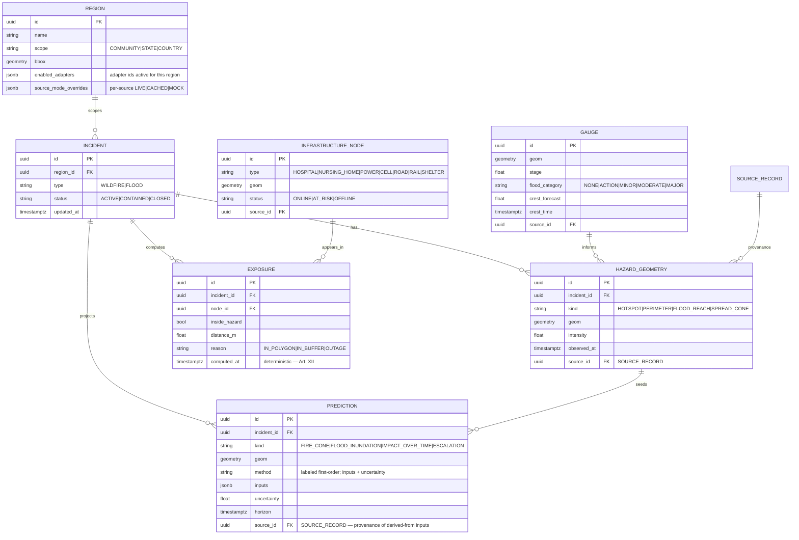
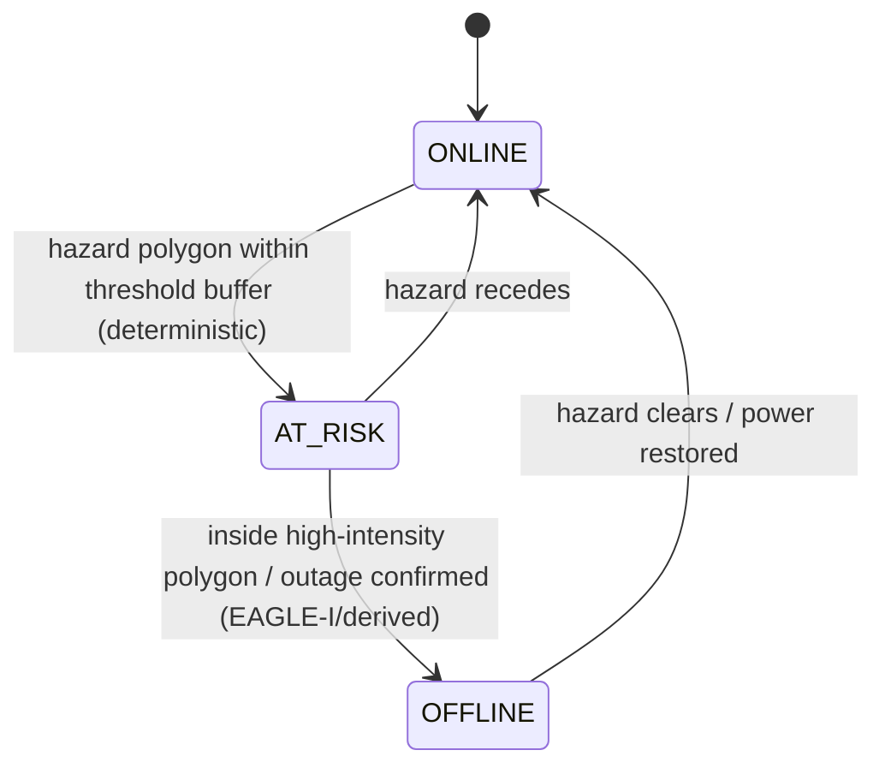

# BEACON — Domain Model & State Machines (S02)

*Canonical entities, relationships, and lifecycle state machines. Refines Phase-2 ARCHITECTURE §7/§7.1
with the locked Phase-3 decisions. This is the basis for the S03 DDL (`schemas/` + Drizzle migrations).
All diagrams are Mermaid (render in GitHub/VS Code). Every datum anchors to `SOURCE_RECORD` (Art. XI);
every `SITREP` field to `CITATION` (Art. XI/XII).*

---

## 1. Core — hazard, exposure & prediction

## 2. Operations, intel & governance

```mermaid
erDiagram
    INCIDENT ||--o{ PUBLIC_REPORT : receives
    INCIDENT ||--o{ SITREP : summarized_by
    INCIDENT ||--o{ ALERT : emits
    INCIDENT ||--o{ RESOURCE_TASK : coordinates
    INCIDENT ||--o{ EVAC_ROUTE : recommends
    THRESHOLD_RULE ||--o{ ALERT : triggers
    SITREP ||--o{ CITATION : cites
    SOURCE_RECORD ||--o{ CITATION : referenced_by
    SOURCE_RECORD ||--o{ PUBLIC_REPORT : provenance
    RESOURCE ||--o{ RESOURCE_TASK : assigned_to
    SHELTER ||--o{ RESOURCE_TASK : staffed_by
    APP_USER ||--o{ AUDIT_EVENT : performs
    PUBLIC_REPORT {
      uuid id PK
      uuid incident_id FK
      string source "WEB|SMS|SOCIAL"
      string status "UNVERIFIED|TRIAGED|VERIFIED|REJECTED"
      float confidence "0..1 deterministic blend"
      jsonb confidence_components "geocode|authority|classifier|corroboration"
      geometry geom_generalized "public view"
      geometry geom_precise "responder-only (Art. XIV)"
      bool consent
      timestamptz purge_after "incident lifecycle (no PII retention)"
      uuid source_id FK
    }
    SITREP {
      uuid id PK
      uuid incident_id FK
      timestamptz generated_at
      string summary
      jsonb priorities "ranked attention areas (deterministic)"
      string trend "ESCALATING|STEADY|DEESCALATING"
      string ai_mode "cloud|local|deterministic-only"
    }
    CITATION {
      uuid id PK
      uuid sitrep_id FK
      uuid source_id FK
      string field "which SITREP field this grounds"
      string claim
    }
    SOURCE_RECORD {
      uuid id PK
      string source
      string adapter
      timestamptz fetched_at
      string license
      string mode "LIVE|CACHED|MOCK"
    }
    ALERT {
      uuid id PK
      uuid incident_id FK
      string cap_status "DRAFT|ACTUAL"
      string category "Fire|Met|Safety"
      string severity "MINOR|MODERATE|SEVERE|EXTREME"
      geometry area
      string edxl_kind "CAP|EDXL_RM|EDXL_SITREP"
      timestamptz sent_at
      uuid approved_by FK "APP_USER — Art. XIII"
      uuid threshold_rule_id FK "THRESHOLD_RULE — set when threshold-fired (EV6 traceability)"
    }
    THRESHOLD_RULE {
      uuid id PK
      string target "GAUGE_CATEGORY|HAZARD_BUFFER"
      string operator "crosses|gte|enters"
      string value
      string scope "region_id"
      string hysteresis
      string cooldown
    }
    RESOURCE {
      uuid id PK
      string kind "CREW|ENGINE|AIRCRAFT|MEDICAL|SUPPLY"
      string status "AVAILABLE|ASSIGNED|OOS"
      geometry geom
      string org
    }
    RESOURCE_TASK {
      uuid id PK
      uuid resource_id FK
      uuid incident_id FK
      string status "PROPOSED|TASKED|ENROUTE|ONSCENE|CLEARED"
      geometry target
      string edxl_rm_ref "mutual-aid round-trip id"
    }
    SHELTER {
      uuid id PK
      geometry geom
      int capacity
      int occupancy
      string status "OPEN|FULL|CLOSED"
      string org "agency-entered/seeded"
    }
    EVAC_ROUTE {
      uuid id PK
      uuid incident_id FK
      geometry geom
      bool avoids_hazard
      timestamptz suggested_start
    }
    APP_USER { uuid id PK string role "PUBLIC|RESPONDER|VERIFIER|EM" string org }
    AUDIT_EVENT {
      uuid id PK
      uuid actor_id FK
      string action
      string target
      timestamptz at
      int cost_tokens_in "nullable — set on LLM/vision/adapter calls (ADR-022)"
      int cost_tokens_out "nullable — set on LLM/vision/adapter calls (ADR-022)"
      numeric cost_usd "nullable — deterministic tokens x tier rate (Art. XII)"
      string model_tier "nullable — CLOUD|LOCAL|DETERMINISTIC|VISION"
    }
```

## 3. State machine — Public report (SOS) lifecycle

```mermaid
stateDiagram-v2
    [*] --> UNVERIFIED: consented intake (EV4)
    UNVERIFIED --> TRIAGED: AI geocode + confidence (deterministic blend)
    TRIAGED --> VERIFIED: VERIFIER/EM approves (EV5; Art. XIII)
    TRIAGED --> REJECTED: human rejects / misinformation
    VERIFIED --> [*]: may emit CAP/EDXL + task resource
    REJECTED --> [*]
    note right of UNVERIFIED
      No outbound CAP/EDXL or tasking
      while UNVERIFIED/TRIAGED (ST1/UW5)
    end note
```

## 4. State machine — Infrastructure node vs hazard

## 5. State machine — Alert (CAP) lifecycle

```mermaid
stateDiagram-v2
    [*] --> DRAFT: threshold rule fires (EV6) OR verifier initiates
    DRAFT --> ACTUAL: VERIFIER/EM approves (Art. XIII)
    DRAFT --> [*]: discarded
    ACTUAL --> [*]: emitted as CAP v1.2 (ready for IPAWS; no live origination)
    note right of DRAFT
      Threshold fires create DRAFT only.
      No auto-ACTUAL (Art. XIII).
    end note
```

## 6. Port ↔ entity mapping (anti-corruption boundary)

| Port | Produces/consumes | Entities |
|---|---|---|
| HazardSource / FloodGauge / Weather (P1–P3) | hazard geometry, gauge stage, alerts | HAZARD_GEOMETRY, GAUGE, ALERT |
| Infrastructure / Outage / Telecom / Population (P4,P5,P13,P12) | lifelines, outages, exposure base | INFRASTRUCTURE_NODE, EXPOSURE |
| NewsIntel + LLM + Vision (P6,P11,Vision) | fused cited synthesis; advisory vision | SITREP, CITATION, SOURCE_RECORD |
| PublicReport (P7) | consented SOS | PUBLIC_REPORT |
| Routing / ResourceLogistics (P8,P9) | evac + logistics + mutual aid | EVAC_ROUTE, RESOURCE, RESOURCE_TASK, SHELTER |
| AlertSink (P10) | outbound interop | ALERT (CAP v1.2 / EDXL-RM / EDXL-SitRep) |
| Repository / EventBus + Queue/Spatial/Cache | persistence, deltas, infra | all (Postgres via Drizzle); deltas via SSE |
| **AICompliancePort** (gateway over P11 LLM + VisionPort; ADR-017) | mandatory chokepoint for every model call — JWT/role → breaker → rate-limit → firewall → policy → PII → cost → audit → upstream; safety fail-closed | produces no canonical entity; writes cost-attributed `AUDIT_EVENT` per call |

> **Contract invariants (contract-tested at S03/S06):** every data response carries `provenance[]` (→
> SOURCE_RECORD) + `freshness`; every SITREP field carries `citations[]`; no `confidence`/ranking/distance
> is LLM-produced (Art. XII); no ALERT reaches ACTUAL without `approved_by` (Art. XIII); `geom_precise` is
> never returned to a non-responder role (Art. XIV).
