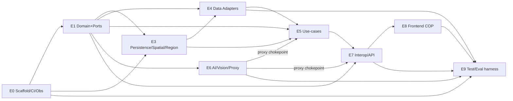

# BEACON — S04 Task Decomposition (build backlog)

*IEEE Response Quest 2026 · Phase 3 · GABBE SDLC **S04** (persona `prod-tech-lead` + `orch-planner`).
Decomposes the S00–S03 spec base into **~496 atomic (≤15-min) tasks** across **9 epics**, each mapped to a
GABBE persona + skills, traced to a requirement/ADR/spec/schema/fitness-function, and organized into
**parallel waves** for concurrent sub-agent execution.*

> **Historical note:** this backlog was PAUSED (no code) until the user approved the S04 gate on
> 2026-07-04. **That gate was approved and S05 implementation is long since complete** — see the
> **STATUS LEDGER (§0, immediately below)** for the current build-complete state. This paragraph is kept
> to preserve the file's original framing at authoring time.

> **This file is the master index + orchestration model.** Task tables live in modular per-epic files under
> [`project/tasks/`](tasks/) (one file per epic → editing one epic never touches another). Legend:
> `TODO · IN_PROGRESS · DONE · BLOCKED` (all start TODO). Tags: `[PARALLEL]` (safe to run concurrently —
> no same-file collision), `[SEC]` (security-critical, blast-radius-segregated), `{skill}` (the GABBE
> skill to apply). *Numbering note: there is deliberately **no epic E2** — persistence/spatial work that
> would have been E2 was consolidated into E3 during decomposition; epic labels were kept stable rather
> than renumbered (change-resilience §1).*

---

## 0. STATUS LEDGER (2026-07-16) — READ THIS FIRST

**All epics E0–E10 are DELIVERED.** The product was built, go-live'd, audited+fixed, and fully delivered
across S05 implementation waves + three post-S09 delivery phases (Phase-B/C/D), all merged to `main`.
**The ~496 per-row statuses below (and in `project/tasks/E*.md`) were never individually hand-marked and are
superseded by this wave-level delivery record** — do NOT hand-mark 496 rows retroactively; this ledger + the
`Trace` column on each row (which still points to the governing FR/ADR/schema/test) is the traceability
mechanism going forward. The authoritative build-state record is
[`docs/audit/FINAL_LIVE_AUDIT.md`](../docs/audit/FINAL_LIVE_AUDIT.md) §6 (Phase-D addendum) and
the internal session tracker (Phase-D) /
resume-3…7 (S05→S09). Session dates below reference `agents/memory/AUDIT_LOG.md`.

| Epic | Planned wave (S04, §3–§4 below) | Actual delivery wave(s) | One-line completion | Trace / pointer |
|---|---|---|---|---|
| **E0** Scaffold/CI/Obs | W0–W3 | S05 **W0** (2026-07-04) + S06 docker gate (2026-07-08) + Phase-C `FEATURE_STORE=postgres` fix (2026-07-13) | package/tsconfig/eslint/vitest/Docker/config-fail-fast delivered; CI **workflows** deferred by explicit user decision (`docs/CI_CD_PLAN.md`), not a gap | AUDIT_LOG 2026-07-04/08/13 |
| **E1** Domain/Ports | W1 | S05 **W1** (2026-07-06) | 19 pure entities + ~20 port interfaces + F9 domain-purity fitness test, green | AUDIT_LOG 2026-07-06 ("W1 COMPLETE") |
| **E3** Persistence/Spatial/Region | W1–W2 | S05 **W2** (2026-07-06); DDL bind-param bug fixed at S06 (2026-07-08) | 19-table Drizzle schema + Repository/Spatial(Turf)/Cache adapters + CA-LIVE/RO-CACHED region registry, proven vs real Postgres | AUDIT_LOG 2026-07-06/08 |
| **E4** Data adapters | W1–W2 (core ~37) + **Phase-D W1** (+14) | S05 **W2–W3** core Part-B (8 adapters, 2026-07-06); **Phase-D W1** (+14 adapters, 2026-07-15) | **22 adapters registered; 20 consumed** on the live COP (itu/camara-gsma stay operator-gated mock plugins by design, not a gap) | FINAL_LIVE_AUDIT §6; resume-15/18 |
| **E5** Application use-cases | W2–W3 | S05 **W2/W3-a** `sitrep-synthesis` keystone (2026-07-06); missing-from-S05 remediation wired **all 6 compute engines live** (2026-07-08); **Phase-D** news-grounding fusion + logistics pre-positioning (2026-07-15) | deterministic engine (exposure/priority/threshold/prediction/routing) + SitRep synthesis all compute-from-input, none seeded | AUDIT_LOG 2026-07-06/08; resume-16/17/18 |
| **E6** AI/Vision/Compliance proxy | W2 | S05 **W2** AI compliance proxy fail-closed (2026-07-06); **Phase-D W4c** vision composed into verify flow (2026-07-15) | LLM ladder + mandatory ComplianceGateway (role-scope→breaker→firewall→policy→PII-redact→audit→seal) in-path; VisionPort advisory, off by default | AUDIT_LOG 2026-07-06; resume-16 |
| **E7** Interop/API/Plugins | W2–W3 | S05 **W3-a** CAP/EDXL/GeoJSON interop (2026-07-06) + **resume-3** routing/logistics/alert-emit/JWT/SSE (2026-07-07); **Phase-D W4a** real ORS routing (2026-07-15) | full CAP+EDXL-RM mutual-aid round-trip; real JWT auth; 28 served endpoints; ORS routing with heuristic fallback | AUDIT_LOG 2026-07-06/07; resume-16 |
| **E8** Frontend COP | W3–W4 | **resume-3** full Next15/React19 build (2026-07-07); map enrichment (2026-07-08); **Phase-D W3a/W3b** outage/cell/weather/floodzone layers + per-layer freshness (2026-07-15) | MapLibre+deck.gl COP, 22 Radix primitives, WCAG 2.2 AA (axe 0 serious/critical), all layers live-wired | AUDIT_LOG 2026-07-07/08; resume-16 |
| **E9** Test/Eval/CI | W1–W5 | harness **W3-a** (2026-07-06); browser gates + 3 redundancy acceptance suites (2026-07-08); **Phase-D W3c/W5-tests** two-tier coverage floor + Playwright regen (2026-07-15) | 188 files/1568 tests, coverage floors enforced, depcruise 499/0, Playwright 53/0/3 designed-skip, axe 0, TTTP 0.81–1.03s | AUDIT_LOG 2026-07-06/08; resume-17/18 |
| **E10** Channels (CLI/messaging) — added mid-S05, not in the original S04 table | n/a (backlog, ADR-023) | headless multi-channel spine — CLI+HTTP+messaging over one core, zero core change (2026-07-07); **Phase-D W4b** real Telegram broadcast+webhook+poller, **ADR-026** (2026-07-15) | 3 channels driving the same hexagonal core; Telegram live `sendMessage` + subscriber registry + HITL-gated broadcast | AUDIT_LOG 2026-07-07; resume-16/17 |
| *(cross-cutting)* Source catalog (DSV §10 deep fallback catalog) | — | **Phase-D W1** (2026-07-15) | the D-31/32/33 deep catalog's remaining un-built rows (gdelt/reliefweb/agency-rss/bluesky/nifc/effis/osm-overpass/worldpop/census/nfhl/eagle-i/opencellid/itu/camara-gsma) all landed as E4 adapters | FINAL_LIVE_AUDIT §6 "Source catalog complete" |

**Final gate (2026-07-15, all epics combined):** `tsc 0 · eslint 0 · vitest 188 files/1568 pass/2 env-gated
skip · coverage two-tier floors pass · depcruise 499 modules/0 violations · next build ✅ · Playwright
53 pass/0 fail/3 designed-skip · axe 0 serious/critical (WCAG 2.2 AA) · TTTP 0.81–1.03s`. Merged to `main`:
PR#1 `4f29d75` (S05) → PR#2 `2ea5769` (Phase-B) → PR#3 `a4828a5` (Phase-C) → PR#4 `6507d95` (Phase-D).
**Remaining work is non-technical:** S08 human GO/NO-GO → 2–5 min demo video → IEEE portal product
submission (entry #5320, deadline 9 Oct 2026) → repo-visibility decision.

---

## 1. Change-management & flexibility model (how tasks stay adaptable)

Per the mandate that any change mid-build reflects into **project management + product + implementation +,
if needed, arch/spec** — the backlog is engineered so a change is *cheap and traceable in every direction*:

- **Golden-thread `Trace` on every task.** Each row carries a Trace key (`FR-#/EV-#/ADR-###/§SPEC/schema/
  F##`). Change flows **both ways**: (a) *spec/arch changes → tasks*: grep the Trace key to find every
  impacted task; (b) *a task surfaces a needed change → spec/arch*: the change is written back to the
  governing artifact (PRD/ADR/SPEC/schema) **and** an ADR is opened/updated, then propagated to all
  Trace-linked tasks. Nothing changes silently.
- **Epic-modular files + composite IDs.** Tasks are addressed as `E<epic>·T-<n>` (e.g. `E5·T-199`). Adding,
  removing, re-ordering, or re-scoping a task inside an epic **never renumbers another epic**. (Raw T-numbers
  intentionally repeat across epics — e.g. `E5·T-240` ≠ `E6·T-240`; the epic prefix disambiguates.)
- **Cross-epic deps are label-based, not ID-based.** A dependency on another epic is written as
  `E1:INCIDENT` / `E7:GET /regions` (a concept/endpoint), not a brittle raw ID — so it survives the other
  epic's renumbering. Only *intra-epic* deps use raw T-numbers.
- **Change-request protocol (classify → route → propagate):**
  1. **Task-only** (rename, split, re-order, add an edge case) → edit the epic file; log one line in
     `agents/memory/AUDIT_LOG.md`. No gate.
  2. **Spec change** (new/changed FR, EARS, schema field, endpoint) → update PRD/SPEC/OpenAPI/schema first
     (spec-driven), then the Trace-linked tasks; **HITL** per AGENTS §9 (ambiguous/breaking).
  3. **Arch change** (new port/adapter, layer boundary, library, flag) → **open/append an ADR**, update
     C4/DOMAIN_MODEL, then tasks; **always HITL** (AGENTS §9 "architectural change"). AGENTS/CONSTITUTION
     stay FROZEN unless the user amends.
- **Built-in flex affordances** (many "changes" are *config or one row*, not a refactor):
  - **Feature flags** (`FEATURE_QUEUE/SPATIAL/CACHE/REALTIME/VISION/ROUTING`, `SOURCE_*_MODE`,
    `AI_MODE`) → swapping CRON↔BullMQ, Turf↔PostGIS, live↔cached↔mock, provider/model is a **config
    change**, not a task rewrite (ADR-012).
  - **Adapter registry (FR-10)** → adding a data source = **one manifest row + one `[PARALLEL]` task**,
    zero core change (E4 Part B is already shaped this way).
  - **Reserved ID headroom** per epic (e.g. E4 `T-171…T-189`) for inserts without renumbering.
  - **Ports isolate churn** → a provider/vendor change touches one adapter behind a stable port; domain +
    use-cases are unaffected (hexagonal, F9).
- **PM ↔ build sync.** This file + the epic tables ARE the PM board (status column). Optional `gabbe sync`
  mirrors `TASKS.md ↔ state.db`; optional `gabbe status` renders the dashboard. `BLOCKED` rows carry a
  reason + "unblocked when" so a pending decision is visible, not silent.

---

## 2. Persona & skill map (GABBE swarm assignment)

| Epic | File | Owner persona(s) | Primary GABBE skills |
|---|---|---|---|
| **E0** Scaffold · CI · Observability | [E0](tasks/E0-foundation-ci-observability.md) | eng-infra · ops-devops · ops-release | configuration-management, dependency-security, supply-chain, observability |
| **E1** Domain · Ports | [E1](tasks/E1-domain-ports.md) | eng-backend (eng-qa) | tdd-cycle, secure-coding, boundary-enforcement |
| **E3** Persistence · Spatial · Region | [E3](tasks/E3-persistence-spatial-region.md) | eng-database · eng-data (eng-qa) | database-design, geospatial, integration-testing, caching |
| **E4** Data adapters | [E4](tasks/E4-data-adapters.md) | eng-data · eng-backend | integration-patterns, resilience, acl, provenance |
| **E5** Application use-cases | [E5](tasks/E5-application-usecases.md) | eng-backend · eng-ml (eng-qa) | tdd-cycle, pbt-strategy, arch-lint, ai-orchestration |
| **E6** AI · Vision · Compliance proxy | [E6](tasks/E6-ai-vision-compliance-proxy.md) | ops-security · prod-safety-engineer · eng-ml | ai-safety-guardrails, prompt-injection-defense, policy-as-code, cost-guardrails, observability-stack-setup |
| **E7** Interop · API · Plugins | [E7](tasks/E7-interop-api-plugins.md) | eng-api · eng-backend (eng-qa) | api-design, contract-testing, auth, realtime |
| **E8** Frontend COP | [E8](tasks/E8-frontend-cop.md) | eng-frontend · ui-design (eng-qa) | browser-tdd, accessibility, deckgl, design-tokens |
| **E9** Test · Eval · CI matrix | [E9](tasks/E9-testing-eval-ci.md) | eng-qa (ops-devops) | testing-strategy, eval-driven-development, chaos-fault-injection, metamorphic-testing, pbt-strategy |
| — | *(orchestration)* | orch-planner (schedule) · orch-judge (7-gate) · orch-coordinator (escalation) | — |

---

## 3. Wave model + dependency DAG (epic granularity)

Tasks are batched into **execution waves**. Within a wave, `[PARALLEL]` tasks run concurrently across
sub-agents; a wave starts when its predecessors are DONE (task-level deps in the epic files refine this).

| Wave | Contents | Concurrency |
|---|---|---|
| **W0** | E0 scaffold + config + CI skeleton (critical spine T-001→T-003→T-006/T-009; config T-012→T-013) | serial spine, then fan-out |
| **W1** | E1 domain+ports · E3 schema/migrations/spatial/cache · E4 framework primitives · E9 harness | **high** (≈120 [PARALLEL]) |
| **W2** | E4 adapters+registry · E5 deterministic engine · **E6 full proxy chain** · E7 interop-schemas+envelope · E9 contract/property/BDD-core | **high**, but E6 chain is **strictly sequential** |
| **W3** | E5 SitRep/decision orchestration (via E6 proxy) · E7 routes+auth+SSE · E8 shell/tokens · E9 BDD-per-FR/e2e/eval-tier1 | medium (auth precedes routes) |
| **W4** | E8 frontend components (≈44 [PARALLEL]) · E9 error/edge suites + chaos harness | **high** |
| **W5** | E9 mutation · chaos · **3 redundancy acceptance tests** · metamorphic · eval-full (nightly) | medium |

**Hard sequencing rules (blast-radius segregation):**
- **E6 AI Compliance Proxy** (`E6·T-256…T-278`) is a **strictly sequential** safety chain and must be DONE
  before any E5/E7 LLM/Vision consumer — never parallelized with its dependents (FR-15, F16 fail-closed).
- **E7 auth** (`E7·T-320…T-325` JWT→RBAC→org-guard) must precede every protected route.
- Only the SitRep/decision paths touch the proxy; the other 20 endpoints are deterministic (tests assert
  zero model calls).

---

## 4. Epic summary

| Epic | Tasks | ID range | Wave(s) | Key deliverables |
|---|---:|---|---|---|
| E0 Scaffold/CI/Obs | 41 | T-001…T-039 | W0–W3 | package/tsconfig/vitest, config fail-fast, Docker, CI (PR+nightly+release), OTel bootstrap |
| E1 Domain/Ports | 54 | T-040…T-093 | W1 | 19 pure entities + VOs, ~20 port interfaces, F9 purity |
| E3 Persistence/Spatial/Region | 42 | T-090…T-129(+T-129a/b) | W1–W2 | Drizzle 19 tables + migrations, Repo/Spatial/Cache adapters, region registry (CA+Romania) |
| E4 Data adapters | 60 | T-130…T-189 (fully allocated) | W1–W2 | adapter framework + FIRMS exemplar + **37 source adapters** = 18 core (T-153–170) + 7 portal-named (D-31, T-171–177) + 12 deep-catalog (D-32, T-178–189: worldwide CAP hub, EONET/GWIS/LANCE, ANM-Romania, EMS-activations, Bluesky, HDX, OpenAQ/Sensor.Community/AirNow, met.no). *(Raw T-numbers repeat across epics by design — composite `E#·T-n` IDs disambiguate, §1.)* |
| E5 Application use-cases | 60 | T-190…T-249 | W2–W3 | deterministic engine (exposure/priority/threshold/prediction/routing/capacity/confidence) + SitRep/decision orchestration |
| E6 AI/Vision/Proxy | 55 | T-240…T-292(+T-278a/292a) | W2 | LLM ladder, VisionPort, mandatory compliance proxy, cost guardrails, OTel GenAI |
| E7 Interop/API/Plugins | 66 | T-290…T-344(+T-320a-e/334a/343a) | W2–W3 | CAP+full-EDXL round-trip, envelope, auth/RBAC, SSE, **22 API operations / 21 paths** (incl. /health/adapters), sustainability+CAMARA plugins |
| E8 Frontend COP | 59 | T-345…T-394 (+T-345a/348a/350a/364a/b/c/389a/394a) | W3–W4 | MapLibre+deck.gl COP, layers+badges (incl. distinct power-outage + cell-coverage layers, D-31), SitRep panel, logistics, SOS/verify, a11y, golden-path e2e |
| E9 Test/Eval/CI | 59 | T-395…T-444e (+T-423a/430a) | W1–W5 | full test matrix, BDD-per-FR triads, 3 redundancy acceptance tests, evals, F1–F19 index, CI wiring |
| **Total** | **~496** | — | W0–W5 | build-ready backlog |

---

## 5. Parallel execution plan (S05 loop — for when the gate is approved)

Per `guides/processes/loki-sdlc-phases.md` S05 and the RARV/TDD cycle:
1. **`orch-planner`** reads this index → selects the next wave's independent `TODO` tasks (a *Parallel
   Group*) → assigns each `E<epic>·T-<n>` to its persona with context (AGENTS + CONTINUITY + Trace target).
2. Each **eng-\*** runs **RARV**: Reason (mini-plan) → **Act (TDD Red test FIRST → `safety-scan` →
   minimal impl)** → Reflect (boundaries/security) → **Verify** (test GREEN, `tsc`, lint, agentic-linter).
3. **`orch-judge`** runs the 7 quality gates per task (coverage ≥99%, EARS/triad coverage, SAST/deps,
   complexity, boundaries); `orch-coordinator` routes failures / raises HITL.
4. Update status → `DONE`; refresh the session tracker; repeat until the wave drains, then advance.
- **Recommended fan-out:** W1 and W4 sustain the most concurrency (~high `[PARALLEL]` density). E6's proxy
  chain runs **one agent, sequentially**. Adapters (E4 Part B) are embarrassingly parallel (one file each).

---

## 6. Consolidated open items

**✅ RESOLVED at the gate (2026-07-01, D-27) — user-approved fixes applied before S05:**
- **`GET /health/adapters` added** to `openapi.yaml` (path + `AdapterHealth`/`AdaptersHealthReport` +
  `System` tag) and SPEC §2.2; new route task `E7·T-334a`. Endpoint count → **23**.
- **Seed region set to Romania (EU Flood)** — `MIGRATION_PLAN.md §5` (name/scope=COUNTRY/bbox/adapters
  +meteoalarm-ro +worldpop + MeteoAlarm-RO source_record + Bucharest/IGSU shelter), `schema.sql` comment,
  SPEC §3.4. **EFAS vs GloFAS reconciled:** GloFAS (global) seeded; EFAS (European) documented as the live
  upgrade — distinct Copernicus products.
- **Compliance-proxy cost caps CONFIRMED (Conservative):** `config/policies.yml` already carries
  `escalation_threshold_usd=0.50`/call, `per_incident_usd=5`, `per_region_usd=50`, `log_retention_days=365`.
- **ADR-008a confirmed to exist** (`ADR-008a-vision-provider-profiles.md`, covers Gemma).
- **AUDIT_EVENT hash-chain persisted:** `prev_hash`/`hash` columns added to `schema.sql` + OpenAPI
  `AuditEvent` (`E1·T-082/083` ↔ `E3·T-104`).
- **E8 COP layout = docked/collapsible panels in one COP** (not separate routes; `E8·T-350`).

**🟠 Remaining for S05 (build-time; do not block the gate):**
- **Live re-verification** of every `⚠` source before `SOURCE_*_MODE=live` (USGS new OGC host, ReliefWeb
  registered appname, NWPS/NFHL reachability); finalize exact Romania endpoints/keys. RO is CACHED; US-only
  sources return `NOT_COVERED` for RO.

**🟡 Confirm values at S05 (defaults are usable):**
- **Priority/confidence tunables** (`E5`): `vulnerability` boost + normalization ceiling, `population`
  normalization basis, `capacity-match` composite direction, `TREND_DEADBAND` boundary — all config-injected.
- **UX (`E8`):** exact "act-in-one-click" target(s); shelter capacity encoding (chose numeric non-color);
  whether a standalone EDXL export view is wanted (currently covered by the verifier CAP-emit control).

*(Tracked in the epic files' "Open items" footers and `agents/memory/AUDIT_LOG.md`.)*

---

## 7. S04 gate (orch-judge self-check)

| Gate question | Result |
|---|---|
| All tasks atomic (≈≤15 min, single file/concern, no "and")? | ✅ ~496 tasks; adapter/route groups split; only E4 Part-B per-adapter rows are deliberately one-each (template-driven) |
| Coverage matches SPEC acceptance criteria? | ✅ every FR-1…16 + F1–F19 + the 3 redundancy tests + 22 API operations (21 paths) + 19 entities + **37 source adapters (+FIRMS exemplar)** trace to ≥1 task |
| Parallel groups correctly identified? | ✅ `[PARALLEL]` on non-colliding tasks; waves W0–W5; DAG encodes cross-epic order |
| Blast-radius / security segregation? | ✅ E6 proxy chain strictly sequential + fail-closed; E7 auth precedes routes; security-sibling tests injected |
| Golden thread intact (req→spec→test→code→audit)? | ✅ Trace column on every row; TDD-first ordering (test before impl) |
| Change-resilience (the flexibility mandate)? | ✅ §1 model — epic-modular files, composite IDs, label deps, flag/registry affordances, change protocol |
| Verdict | **PASS — build-ready backlog; awaiting human S04 gate approval.** |

**Next (on approval):** begin **S05** at Wave W0 (E0 scaffold) → W1 fan-out. **Do not start until the user
approves.** No auto-commit; AGENTS.md/CONSTITUTION.md FROZEN; Phase-2 untouched.

---
*Generated at S04 by prod-tech-lead + orch-planner via 9 parallel GABBE-persona decomposition agents,
2026-07-01. Task tables: [`project/tasks/`](tasks/).*

---

## 8. E12 — Live-Demo Delivery Increment (post-S08, 2026-08-07)

Plan of record: [`docs/LIVE_DEMO_DELIVERY_PLAN.md`](../docs/LIVE_DEMO_DELIVERY_PLAN.md) (20 locked
decisions in §0). Requirements: [`docs/requirements/EARS_ADDENDUM_LIVE_DEMO.md`](../docs/requirements/EARS_ADDENDUM_LIVE_DEMO.md)
(FR-LD-1…). Decision record: [`ADR-037`](../docs/architecture/decisions/ADR-037-live-demo-delivery-increment.md).

Tracked per SESSION rather than per atomic task — the increment's GABBE cadence is batched by explicit
entrant decision (plan §1.8, decision 20), with Article I enforced at each session gate: nothing ships
without a test, and the full battery runs before a session is called done.

| Session | Scope | Status |
|---|---|---|
| S1 | Backend: durable pg logistics + shared store contract · sitrep/citation/evac write paths · editable `config/shelters.json` · honest 5xx on schema faults · `CAPACITY_MATCH_DIRECTION` wired · 5 planned GET routes + all-clear documented · scheduler seam + retention purge scheduled · demo monitoring watcher · `FEATURE_EXTERNAL_VIEWS` consumer | **DONE 2026-08-07** (commit 3be1e5e; 4020 tests, all gates green) |
| S2 | **NEXT** — All remaining sources live (Mastodon social, ~11 adapters, AirQuality port, FIRMS+GDACS per region, mode truth-up) + live vision ladder (`VISION_*` wired, OpenRouter provider, GIBS/Copernicus imagery) | TODO |
| S3 | UI completion (5 D4/D6 panels, MapFeatureList ×14, ShelterCapacityWidget, session persistence) + docs truth-up + full sweep + single batched baseline re-mint | TODO |
| S4 | Live dry-run of every demo scenario with rehearsed fallbacks · Railway check · judge repo · final evidence | TODO |
